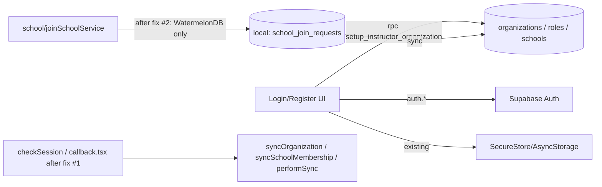

# Auth Module — Specification (as-built + remediation)

## 📝 TLDR
This document specifies the `auth` module as it exists today (email/password + Google OAuth sign-in, instructor/student registration, session persistence, role derivation), and proposes fixes for the gaps found while reading the code. Today a student who joins a school via code sees nothing until an instructor approves the request; Phase 2 below changes that so the student sees themselves as affiliated with the school (status: pending) immediately after joining. Password reset / email verification do not exist yet — flagged as a near-term follow-up feature (Phase 3), to be spec'd in full separately when scheduled.

## 📝 Problem Statement
No specification exists for `auth` today. Reading the code surfaced concrete defects:
- A student joining a school gets no immediate feedback that the join succeeded — the school only appears once an instructor approves the request, which can take hours/days. This is a UX gap the business has asked to close.
- The Google OAuth callback path skips organization/school-membership sync that every other login path performs, so an OAuth user's local state can silently lag behind an email/password user's.
- `joinSchoolService.ts` reads Supabase tables directly (`school_invites`, `school_join_requests`, `school_members`) instead of going through WatermelonDB, violating the CLAUDE.md rule that only `auth.*`, `storage.*`, named `rpc()` calls, and the sync edge function may touch Supabase directly. This bypasses the offline-first guarantee for join-code validation.
- There is no password-reset or email-verification flow; the "Forgot password" button is a no-op TODO. The business intends to build this soon.
- Role (Owner/Instructor vs Student) is never stored on a record — it's inferred at runtime from three tables and cached ad hoc in SecureStore/AsyncStorage, unlike every other module's repository + `.observe()` pattern.

## 📝 Proposed Solution
Keep the existing architecture (Supabase Auth for identity, RPC for org bootstrap, WatermelonDB + sync for everything else) — no rewrite. Apply four targeted, independently shippable fixes:

Three independently shippable fixes — none depends on another to function, each can be its own PR/deploy:

1. **Storage helper dedup** — extract the three copy-pasted `safeStorageGet/Set/Delete` implementations (`useAuth.ts`, `useRegisterInstructor.ts`, `app/auth/callback.tsx`) into one shared helper in `src/modules/auth/services/`. Pure refactor, zero behavior change.
2. **OAuth callback parity** — `app/auth/callback.tsx` calls the same `syncOrganization` / `syncSchoolMembership` / `performSync(true)` sequence `checkSession()` already runs, so an OAuth login reaches the same local state as an email login. Ships independently of #1 (only reuses its helper if #1 has already landed; otherwise adds its own inline copy, still correct).
3. **Join flow visibility + compliance fix** — replace `joinSchoolService.ts`'s direct `supabase.from(...)` reads with local WatermelonDB queries (duplicate-request/already-member checks run against locally-synced `school_join_requests`/`school_members`, refreshed via the existing sync mechanism, not ad hoc direct reads). The student's own `school_join_requests` row (already created locally today) becomes observable from the student dashboard, showing the school immediately with a "Pending approval" status instead of nothing. No bypass of instructor approval — this only makes the *existing* pending state visible. Touches only `school`-module files; fully independent of #1/#2.

**Password reset / email verification** is explicitly *not* one of the three fixes above — it is out of scope for this spec's implementation plan and recorded here as a Non-goal for now (see Risks), because the business has confirmed it's needed soon but not yet scheduled for design. It should get its own spec (data: Supabase's built-in `resetPasswordForEmail` + a deep-linked reset screen, mirroring the existing `callback.tsx` OAuth deep-link pattern) once scheduled.

Role-inference is **not** changed by this spec — kept as-is and documented as an accepted architectural risk (see Risks & Impact Review), since replacing it with a stored role/profile model is a larger, separate migration.

## 📝 Architecture
- **Identity**: Supabase Auth (`auth.signUp`, `auth.signInWithPassword`, `auth.signInWithOAuth`, `auth.setSession`, `auth.getSession`, `auth.refreshSession`) — the only direct Supabase calls other than the two below.
- **Org bootstrap**: `supabase.rpc('setup_instructor_organization', ...)` — security-definer RPC, creates `organizations` (owner = user), default `organization_roles` (Owner/Instructor/Student), and the first `schools` row. Owned by `registerInstructor.ts`.
- **Join-by-code**: owned by the `school` module (`joinSchoolService.ts`), not `auth`. After fix #2, all reads go through WatermelonDB (`SchoolInviteRepository`, `SchoolJoinRequestRepository`, `SchoolMemberRepository`); only the initial write triggers `sync()`.
- **Session state**: Zustand store (`src/store/index.ts`) holds `session`, `organization`, `schoolMemberships`; no `role` field — derived by callers.
- **Persistence**: Expo SecureStore on native, AsyncStorage fallback on web (document explicitly — CLAUDE.md's "SecureStore" claim is native-only in practice).
- **No local WatermelonDB table for user/profile** — `authSchema` is intentionally empty; role/affiliation is derived from `organizations`, `school_members`, `organization_roles` (all owned by `organization`/`school` modules).

Takeaway: `auth` only owns identity + org bootstrap; affiliation state (join, pending, approval) is entirely a `school`/`organization` concern that `auth` merely triggers a sync for.

## 📝 Data Model
No schema changes proposed. For reference, the tables `auth` interacts with (all owned by other modules/Supabase, not by `auth` itself):
- `organizations` (`owner_id`), `organization_roles` (`organization_id`, `name`), `schools`, `school_members` (`school_id`, `role_id`, `status`), `school_join_requests` (`school_id`, `student_id`, `status: pending|approved|rejected`).
- Fix #2 requires `school_join_requests` and `school_members` to already be present locally when the duplicate/already-member checks run — this depends on `sync()` having completed at least once after login; if a device has never synced, the checks fall back to "no local record found" (fail-open to allow the join attempt, since Supabase's own unique constraints are the backstop — document as accepted behavior, not a new gap).

## 📝 API Contracts
No new endpoints. Existing contracts, documented for the first time:
- `supabase.auth.signUp({ email, password, options: { emailRedirectTo: undefined } })` — email confirmation deliberately disabled (MVP decision, depends on a manual Supabase Dashboard toggle outside the codebase — documented as an operational dependency, not asserted in code).
- `supabase.rpc('setup_instructor_organization', { organization_name, school_name })` → `{ organization_id, school_id }` (per `registerInstructor.ts` JSDoc).
- `supabase.auth.signInWithOAuth({ provider: 'google', options: { redirectTo: 'evolync://auth/callback' } })`, completed by `app/auth/callback.tsx` reading `access_token`/`refresh_token` and calling `auth.setSession`.

## 📝 UI/UX
- `/auth/login`, `/auth/register`, `/auth/register/instructor`, `/auth/register/user`, `/auth/callback` (OAuth deep link) — unchanged by this spec except for fix #1's added sync call (no visible UI change, only faster-consistent state).
- Fix #2 UI change: student's home/dashboard shows the joined school with a "Pending approval" badge as soon as the join request is created locally (today it shows nothing until approval) — reuses existing `BaseCard` list pattern, no new component beyond a status badge.
- "Forgot password" button remains visually present but inert until Phase 3 is scheduled — no UI change now; do not remove it, since the business wants it built soon.

## 📝 Edge Cases & Failure Scenarios
| Scenario | Current behavior | Behavior after this spec |
|---|---|---|
| Student joins school, offline | Join request queued locally, `sync()` fire-and-forget fails silently until reconnect | Unchanged, but now visible locally as "Pending" immediately (fix #2) regardless of sync success |
| Student joins school, device never synced before | Direct Supabase reads for duplicate-check (today) | Local WatermelonDB check finds nothing → allows join attempt; Supabase unique constraint is the backstop (documented, accepted) |
| Google OAuth login | No org/membership sync until another trigger fires | Same sync sequence as email login (fix #1) |
| Session expired + offline | Cached/stale session accepted for local DB access (deliberate offline-first exception) | Unchanged — out of scope, already intentional |
| Duplicate email at registration | Substring match on raw Supabase error text (`"already registered"`) | Unchanged — fragile but out of scope for this pass |
| "Forgot password" tapped | No-op console.log | Unchanged — Phase 3, not built here |

## 📝 Risks & Impact Review
- **Role has no stored record** (accepted as risk, not fixed here): role is inferred per-call from three tables with no reactive `.observe()`, unlike every other module. Impact: any future feature needing "current user's role" reactively (e.g. a role-based nav guard) must re-derive it manually or add ad hoc caching — a maintenance risk to flag for anyone building on top of `auth`, not something this spec resolves.
- **Fix #3 depends on prior sync completing** — on a first-ever join attempt right after install with no network, the duplicate-check fail-open behavior relies on Supabase's own constraints; acceptable but should be called out to QA.
- **Password reset is a hard business need but unscheduled** — recorded here as a Non-goal *for this spec only*, not a permanent decision; do not treat its absence as resolved.
- Fixes #1–#3 touch only `auth`/`school` internals, no public contract or schema change — low blast radius, fully reversible (revert the sync call / revert the query source).

## 📋 Phasing
Each fix below is independently shippable — no fix requires another to function; they are listed in the order that minimizes rework, not because of a dependency:
- **Fix #1** — Storage helper dedup. Pure refactor, no behavior change.
- **Fix #2** — OAuth callback sync parity. Bug fix, no user-visible change beyond consistency.
- **Fix #3** — Join flow compliance + visibility: route `joinSchoolService.ts` through WatermelonDB; surface pending join requests on the student dashboard.
- **(Separate future spec, not designed here)** — Password reset + email verification.

## 📋 Implementation Plan

1. Extract `safeStorageGet/Set/Delete` into `src/modules/auth/services/secureStorage.ts`; replace the three duplicated inline copies. Test: existing session-restore/login/OAuth tests still pass with no behavior change.
2. Add `syncOrganization()` / `syncSchoolMembership()` / `performSync(true)` calls to `app/auth/callback.tsx` after `auth.setSession`, mirroring `checkSession()`. Test: OAuth login followed immediately by dashboard load shows correct organization/membership without a manual refresh.
3. Replace `joinSchoolService.ts`'s direct `supabase.from('school_invites'|'school_join_requests'|'school_members')` reads with `SchoolInviteRepository`/`SchoolJoinRequestRepository`/`SchoolMemberRepository` queries against local WatermelonDB. Test: join-by-code succeeds/fails identically offline and online (mock repositories for both cases).
4. Add an `observe*` method on `SchoolJoinRequestRepository` (if not already present) filtered by current student id; wire student dashboard to show a "Pending approval" card per unresolved join request. Test: after submitting a join code, the school appears on the dashboard with a pending badge without navigating away or refreshing.
5. Confirm instructor-approval flow (in `school`/`organization` module, out of this module's scope) still transitions the same local record to an active `SchoolMember`, so the pending card correctly updates to active status once approved. Test: end-to-end join → approve → dashboard shows active membership.
