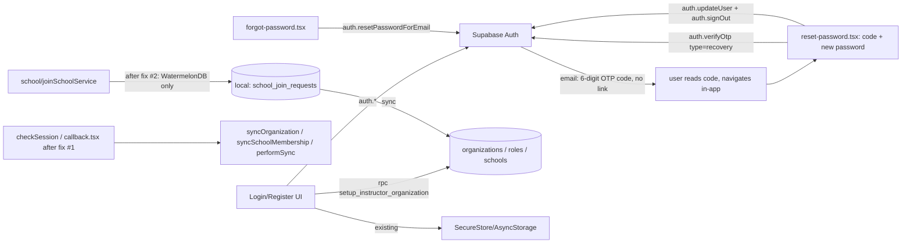

# Auth Module — Specification (as-built + remediation)

## 📝 TLDR
This document specifies the `auth` module as it exists today (email/password + Google OAuth sign-in, instructor/student registration, session persistence, role derivation, password reset), and proposes fixes for the gaps found while reading the code. Today a student who joins a school via code sees nothing until an instructor approves the request; Phase 2 below changes that so the student sees themselves as affiliated with the school (status: pending) immediately after joining. Email verification does not exist yet — remains a near-term follow-up, to be spec'd separately when scheduled.

> **Update (2026-09-29):** Fix #4 — password reset via Supabase Auth — has been implemented and shipped (see Phasing and Implementation Plan below). It was built directly rather than through a dedicated spec; this document has been retrofitted to describe it as-built.
>
> **Revision (2026-09-29, same day):** the first version of Fix #4 used a deep-linked magic-link email (`resetPasswordForEmail({ redirectTo: 'evolync://auth/reset-password' })`), following the existing OAuth `callback.tsx` pattern. On first real-world test the email linked to `http://localhost:3000` instead of the app, because the hosted Supabase project's Redirect URLs allow-list didn't contain our custom scheme, so Supabase silently fell back to its default `site_url`. Rather than depend on that Dashboard configuration being correct forever, the flow was **redesigned to use an emailed 6-digit OTP code** the user types into the app instead of tapping a link — this needs no redirect URL, no `site_url`, and no deep-link handling at all for this feature. All content below describes the **current, OTP-based** design; the magic-link version is superseded and no longer in the codebase.

## 📝 Problem Statement
No specification exists for `auth` today. Reading the code surfaced concrete defects:
- A student joining a school gets no immediate feedback that the join succeeded — the school only appears once an instructor approves the request, which can take hours/days. This is a UX gap the business has asked to close.
- The Google OAuth callback path skips organization/school-membership sync that every other login path performs, so an OAuth user's local state can silently lag behind an email/password user's.
- `joinSchoolService.ts` reads Supabase tables directly (`school_invites`, `school_join_requests`, `school_members`) instead of going through WatermelonDB, violating the CLAUDE.md rule that only `auth.*`, `storage.*`, named `rpc()` calls, and the sync edge function may touch Supabase directly. This bypasses the offline-first guarantee for join-code validation.
- ~~There is no password-reset or email-verification flow; the "Forgot password" button is a no-op TODO.~~ **Resolved by Fix #4**: password reset now works end-to-end via `supabase.auth.resetPasswordForEmail` + an emailed 6-digit OTP code the user enters in-app (no deep link). Email verification remains unbuilt (separate, still-unscheduled follow-up).
- Role (Owner/Instructor vs Student) is never stored on a record — it's inferred at runtime from three tables and cached ad hoc in SecureStore/AsyncStorage, unlike every other module's repository + `.observe()` pattern.

## 📝 Proposed Solution
Keep the existing architecture (Supabase Auth for identity, RPC for org bootstrap, WatermelonDB + sync for everything else) — no rewrite. Apply four targeted, independently shippable fixes:

Four independently shippable fixes — none depends on another to function, each can be its own PR/deploy:

1. **Storage helper dedup** — extract the three copy-pasted `safeStorageGet/Set/Delete` implementations (`useAuth.ts`, `useRegisterInstructor.ts`, `app/auth/callback.tsx`) into one shared helper in `src/modules/auth/services/`. Pure refactor, zero behavior change.
2. **OAuth callback parity** — `app/auth/callback.tsx` calls the same `syncOrganization` / `syncSchoolMembership` / `performSync(true)` sequence `checkSession()` already runs, so an OAuth login reaches the same local state as an email login. Ships independently of #1 (only reuses its helper if #1 has already landed; otherwise adds its own inline copy, still correct).
3. **Join flow visibility + compliance fix** — replace `joinSchoolService.ts`'s direct `supabase.from(...)` reads with local WatermelonDB queries (duplicate-request/already-member checks run against locally-synced `school_join_requests`/`school_members`, refreshed via the existing sync mechanism, not ad hoc direct reads). The student's own `school_join_requests` row (already created locally today) becomes observable from the student dashboard, showing the school immediately with a "Pending approval" status instead of nothing. No bypass of instructor approval — this only makes the *existing* pending state visible. Touches only `school`-module files; fully independent of #1/#2.
4. **Password reset** *(implemented 2026-09-29, redesigned same day — see Revision note above)* — `useAuth.ts` gained three methods: `sendPasswordResetEmail(email)` (`supabase.auth.resetPasswordForEmail(email)`, no `redirectTo`), `verifyRecoveryOtp(email, code)` (`supabase.auth.verifyOtp({ email, token: code, type: 'recovery' })`, establishes a temporary recovery session), and `updatePassword(newPassword)` (`supabase.auth.updateUser`). Two new screens: `app/auth/forgot-password.tsx` (email entry → navigates to the next screen, passing the email as a route param — a normal in-app navigation, not a deep link) and `app/auth/reset-password.tsx` (single form: 6-digit code + new password + confirm, submitted together — verifies the OTP, then immediately sets the password, then `signOut()` so the user re-authenticates fresh). The previously inert "Forgot password" button in `LoginForm.tsx` now navigates to the first screen. Fully independent of #1–#3, and — unlike the superseded magic-link version — has **no dependency on Supabase Dashboard Redirect URL / Site URL configuration**.

Email verification remains a Non-goal — still out of scope, unscheduled (see Risks).

Role-inference is **not** changed by this spec — kept as-is and documented as an accepted architectural risk (see Risks & Impact Review), since replacing it with a stored role/profile model is a larger, separate migration.

## 📝 Architecture
- **Identity**: Supabase Auth (`auth.signUp`, `auth.signInWithPassword`, `auth.signInWithOAuth`, `auth.setSession`, `auth.getSession`, `auth.refreshSession`, `auth.resetPasswordForEmail`, `auth.verifyOtp`, `auth.updateUser`, `auth.signOut`) — the only direct Supabase calls other than the two below.
- **Org bootstrap**: `supabase.rpc('setup_instructor_organization', ...)` — security-definer RPC, creates `organizations` (owner = user), default `organization_roles` (Owner/Instructor/Student), and the first `schools` row. Owned by `registerInstructor.ts`.
- **Join-by-code**: owned by the `school` module (`joinSchoolService.ts`), not `auth`. After fix #2, all reads go through WatermelonDB (`SchoolInviteRepository`, `SchoolJoinRequestRepository`, `SchoolMemberRepository`); only the initial write triggers `sync()`.
- **Session state**: Zustand store (`src/store/index.ts`) holds `session`, `organization`, `schoolMemberships`; no `role` field — derived by callers.
- **Persistence**: Expo SecureStore on native, AsyncStorage fallback on web (document explicitly — CLAUDE.md's "SecureStore" claim is native-only in practice).
- **No local WatermelonDB table for user/profile** — `authSchema` is intentionally empty; role/affiliation is derived from `organizations`, `school_members`, `organization_roles` (all owned by `organization`/`school` modules).

Takeaway: `auth` only owns identity + org bootstrap; affiliation state (join, pending, approval) is entirely a `school`/`organization` concern that `auth` merely triggers a sync for.

## 📝 Data Model
No schema changes proposed. For reference, the tables `auth` interacts with (all owned by other modules/Supabase, not by `auth` itself):
- `organizations` (`owner_id`), `organization_roles` (`organization_id`, `name`), `schools`, `school_members` (`school_id`, `role_id`, `status`), `school_join_requests` (`school_id`, `student_id`, `status: pending|approved|rejected`).
- Fix #2 requires `school_join_requests` and `school_members` to already be present locally when the duplicate/already-member checks run — this depends on `sync()` having completed at least once after login; if a device has never synced, the checks fall back to "no local record found" (fail-open to allow the join attempt, since Supabase's own unique constraints are the backstop — document as accepted behavior, not a new gap).

## 📝 API Contracts
No new endpoints. Existing contracts, documented for the first time:
- `supabase.auth.signUp({ email, password, options: { emailRedirectTo: undefined } })` — email confirmation deliberately disabled (MVP decision, depends on a manual Supabase Dashboard toggle outside the codebase — documented as an operational dependency, not asserted in code).
- `supabase.rpc('setup_instructor_organization', { organization_name, school_name })` → `{ organization_id, school_id }` (per `registerInstructor.ts` JSDoc).
- `supabase.auth.signInWithOAuth({ provider: 'google', options: { redirectTo: 'evolync://auth/callback' } })`, completed by `app/auth/callback.tsx` reading `access_token`/`refresh_token` and calling `auth.setSession`.
- `supabase.auth.resetPasswordForEmail(email)` — **no `redirectTo`**. Triggers Supabase's "Reset Password" email template (custom-branded HTML in `supabase/email-templates/reset-password.html`, using `{{ .Token }}` — the 6-digit OTP code — instead of `{{ .ConfirmationURL }}`). Always resolves without revealing whether the email exists (Supabase's own behavior); the UI shows the same request-submitted state regardless (no separate "check your inbox" screen — the user is taken straight to the code-entry screen).
- `supabase.auth.verifyOtp({ email, token: code, type: 'recovery' })` — verifies the 6-digit code and, on success, establishes a session (`data.session`) scoped to the recovery flow. Called from `app/auth/reset-password.tsx` before `updateUser`. On failure (wrong/expired/already-used code), Supabase returns an error whose message contains "token" + "expired"/"invalid", mapped by `mapSupabaseError` to `errorInvalidOtpCode`.
- `supabase.auth.updateUser({ password })` — sets the new password on the session `verifyOtp` just established, then `auth.signOut()` immediately invalidates that session so the user re-authenticates with `signInWithEmail` afterward (no auto-login).
- **No Supabase Dashboard URL configuration is required for this feature** (a deliberate design choice — see Revision note in TLDR). The email template must still be pasted into Dashboard → Authentication → Email Templates → Reset Password (a manual, one-time content step, not a URL/security setting).

## 📝 UI/UX
- `/auth/login`, `/auth/register`, `/auth/register/instructor`, `/auth/register/user`, `/auth/callback` (OAuth deep link) — unchanged by this spec except for fix #1's added sync call (no visible UI change, only faster-consistent state).
- Fix #2 UI change: student's home/dashboard shows the joined school with a "Pending approval" badge as soon as the join request is created locally (today it shows nothing until approval) — reuses existing `BaseCard` list pattern, no new component beyond a status badge.
- Fix #4 UI change: "Forgot password" button in `LoginForm.tsx` now navigates to `/auth/forgot-password` (previously a no-op). Two new screens, both following the existing `login.tsx` layout conventions (`AppLogo`, `ErrorBanner`, `KeyboardAvoidingView` + `ScrollView`):
  - `/auth/forgot-password` — `ForgotPasswordForm` (email only, RHF+Zod). On submit, immediately navigates to `/auth/reset-password?email=...` (in-app route param, not a deep link) — no intermediate "check your inbox" screen. Deliberately never reveals whether the email exists.
  - `/auth/reset-password` — `ResetPasswordForm`: a single form with a 6-digit code field (numeric keypad, large centered digits), new password, and confirm password, submitted together. Header text includes the target email when known ("Wpisz kod wysłany na {{email}}"). A "Request new code" link returns to `/auth/forgot-password`. On success, a confirmation state with a CTA to sign in.

## 📝 Edge Cases & Failure Scenarios
| Scenario | Current behavior | Behavior after this spec |
|---|---|---|
| Student joins school, offline | Join request queued locally, `sync()` fire-and-forget fails silently until reconnect | Unchanged, but now visible locally as "Pending" immediately (fix #2) regardless of sync success |
| Student joins school, device never synced before | Direct Supabase reads for duplicate-check (today) | Local WatermelonDB check finds nothing → allows join attempt; Supabase unique constraint is the backstop (documented, accepted) |
| Google OAuth login | No org/membership sync until another trigger fires | Same sync sequence as email login (fix #1) |
| Session expired + offline | Cached/stale session accepted for local DB access (deliberate offline-first exception) | Unchanged — out of scope, already intentional |
| Duplicate email at registration | Substring match on raw Supabase error text (`"already registered"`) | Unchanged — fragile but out of scope for this pass |
| "Forgot password" tapped | No-op console.log | Fix #4: navigates to `/auth/forgot-password`, sends reset email with a 6-digit code |
| Code entered wrong, expired, or already used | N/A (flow didn't exist) | `verifyOtp` fails → inline error banner (`errorInvalidOtpCode`) on the same screen, form stays filled except the code field; "Request new code" link available; no crash |
| User closes the app between requesting a code and entering it | N/A | No local state to lose beyond the typed-in email (passed as a route param, not persisted) — user re-enters `/auth/forgot-password` and requests a fresh code if needed |
| User requests a reset while already logged in | N/A | `verifyOtp` overwrites the active session with the recovery session for the duration of the reset screen only; `signOut()` on success clears it, forcing a fresh login (acceptable — explicit user action) |
| User requests reset for a non-existent email | N/A | Supabase resolves silently either way; UI proceeds to the same code-entry screen regardless (no account enumeration) |
| Reset code intercepted/forwarded to someone else | N/A | Same risk profile as any OTP-based flow (SMS 2FA, etc.) — mitigated by Supabase's built-in expiry + single-use enforcement on the token; not a new risk class for this codebase |

## 📝 Risks & Impact Review
- **Role has no stored record** (accepted as risk, not fixed here): role is inferred per-call from three tables with no reactive `.observe()`, unlike every other module. Impact: any future feature needing "current user's role" reactively (e.g. a role-based nav guard) must re-derive it manually or add ad hoc caching — a maintenance risk to flag for anyone building on top of `auth`, not something this spec resolves.
- **Fix #3 depends on prior sync completing** — on a first-ever join attempt right after install with no network, the duplicate-check fail-open behavior relies on Supabase's own constraints; acceptable but should be called out to QA.
- **Email verification remains a hard business need but unscheduled** — recorded here as a Non-goal *for this spec only*, not a permanent decision; do not treat its absence as resolved. (Password reset, previously grouped with it, is now built — see Fix #4.)
- **Fix #4's original magic-link design was confirmed broken on the hosted project** (2026-09-29): the reset email linked to `localhost:3000` because the Redirect URLs allow-list didn't contain our scheme. Rather than chase that Dashboard configuration, the flow was redesigned around an OTP code (see Revision note in TLDR), which has no such dependency. **Outstanding**: the redesigned OTP flow has been verified by compile (`tsc --noEmit`) and locale JSON validity only — it has **not yet been verified against a real hosted Supabase project or a live email send** (still requires pasting `supabase/email-templates/reset-password.html` into Dashboard → Authentication → Email Templates → Reset Password, a content-only step with no URL/security configuration). No Management API/CLI credentials are available in this environment ([.env](../../.env) has only the public anon key) to verify or apply this remotely.
- **OTP codes are a well-trodden pattern but shift UX friction from "tap a link" to "switch apps, remember 6 digits, type them back"** — acceptable trade-off for a mobile app where deep-link reliability (Redirect URL config, Universal/App Links, email clients that don't open custom schemes) is otherwise a recurring failure class; not free, but the failure mode is more visible/debuggable to an end user (wrong code → explicit error) than a magic link silently pointing at the wrong host.
- Fixes #1–#4 touch only `auth`/`school` internals, no public contract or schema change — low blast radius, fully reversible (revert the sync call / revert the query source / revert the two new screens and hook methods).

## 📋 Phasing
Each fix below is independently shippable — no fix requires another to function; they are listed in the order that minimizes rework, not because of a dependency:
- **Fix #1** — Storage helper dedup. Pure refactor, no behavior change. *Status: not yet implemented.*
- **Fix #2** — OAuth callback sync parity. Bug fix, no user-visible change beyond consistency. *Status: not yet implemented.*
- **Fix #3** — Join flow compliance + visibility: route `joinSchoolService.ts` through WatermelonDB; surface pending join requests on the student dashboard. *Status: not yet implemented.*
- **Fix #4** — Password reset via Supabase Auth. *Status: ✅ implemented 2026-09-29* (see Implementation Plan below).
- **(Separate future spec, not designed here)** — Email verification.

## 📋 Implementation Plan

1. Extract `safeStorageGet/Set/Delete` into `src/modules/auth/services/secureStorage.ts`; replace the three duplicated inline copies. Test: existing session-restore/login/OAuth tests still pass with no behavior change.
2. Add `syncOrganization()` / `syncSchoolMembership()` / `performSync(true)` calls to `app/auth/callback.tsx` after `auth.setSession`, mirroring `checkSession()`. Test: OAuth login followed immediately by dashboard load shows correct organization/membership without a manual refresh.
3. Replace `joinSchoolService.ts`'s direct `supabase.from('school_invites'|'school_join_requests'|'school_members')` reads with `SchoolInviteRepository`/`SchoolJoinRequestRepository`/`SchoolMemberRepository` queries against local WatermelonDB. Test: join-by-code succeeds/fails identically offline and online (mock repositories for both cases).
4. Add an `observe*` method on `SchoolJoinRequestRepository` (if not already present) filtered by current student id; wire student dashboard to show a "Pending approval" card per unresolved join request. Test: after submitting a join code, the school appears on the dashboard with a pending badge without navigating away or refreshing.
5. Confirm instructor-approval flow (in `school`/`organization` module, out of this module's scope) still transitions the same local record to an active `SchoolMember`, so the pending card correctly updates to active status once approved. Test: end-to-end join → approve → dashboard shows active membership.

### Fix #4 — Password reset (as-built, 2026-09-29; redesigned same day from magic-link to OTP)
6. Add `sendPasswordResetEmail(email)` (`supabase.auth.resetPasswordForEmail(email)`, no `redirectTo`), `verifyRecoveryOtp(email, code)` (`supabase.auth.verifyOtp({ email, token: code, type: 'recovery' })`), and `updatePassword(newPassword)` (`supabase.auth.updateUser`) to `useAuth.ts`, following the existing `signInWithEmail` pattern (network check → `supabase.auth.*` call → `mapSupabaseError` on failure → `setLoading`/`clearError`). Extended `mapSupabaseError` with weak-password, same-password, and invalid/expired-OTP-token cases.
7. Add `forgotPasswordSchema.ts` (email only) and `resetPasswordSchema.ts` (6-digit numeric `code` + `password` + `confirmPassword`, reusing the `passwordRegex` exported from `registerSchema.ts`) under `validation/`.
8. Add `ForgotPasswordForm.tsx` (unchanged from the magic-link version) and rewrite `ResetPasswordForm.tsx` under `components/` to add the code field (a plain `Controller` + Tamagui `Input`, `keyboardType="number-pad"`, `maxLength={6}`, digit-only sanitization on change — a one-off field, not promoted to a shared core component) alongside the existing `PasswordInput`/`SubmitButton` fields.
9. Rewrite `app/auth/forgot-password.tsx`: on successful `sendPasswordResetEmail`, navigate directly to `/auth/reset-password` with the email as a route param (`router.replace({ pathname: ..., params: { email } })`) instead of showing a "check your inbox" screen — the next screen carries that messaging.
10. Rewrite `app/auth/reset-password.tsx`: no more `useLocalSearchParams` token reading or `setSession`-based link validation. Reads only `email` from route params, renders `ResetPasswordForm`, and on submit runs `verifyRecoveryOtp` → `updatePassword` → `signOut()` in sequence, short-circuiting on the first failure (error stays visible, user can retry without re-entering already-valid fields).
11. Wire the existing "Forgot password" button in `LoginForm.tsx` to `router.push('/auth/forgot-password')` (unchanged from the magic-link version).
12. Rewrite `supabase/email-templates/reset-password.html` to display `{{ .Token }}` (large, centered, letter-spaced) instead of a `{{ .ConfirmationURL }}` button/link. Removed `evolync://auth/reset-password` from `supabase/config.toml`'s `[auth].additional_redirect_urls` (no longer needed — kept only `evolync://auth/callback` for Google OAuth) and removed the `site_url` override added in the superseded version, replacing both with a comment explaining why they're gone. Test: manually verified compile (`tsc --noEmit`) and locale JSON validity; **not yet verified against a real hosted Supabase project or a live email send** — flagged as an outstanding verification step before this is considered fully QA'd. The email template still requires a one-time manual paste into Dashboard → Authentication → Email Templates → Reset Password.
13. Updated `en.json`/`pl.json`: removed the magic-link-only keys (`resetLinkSent`, `resetLinkSentMessage`, `invalidResetLink`, `invalidResetLinkMessage`, `requestNewLink`) after confirming no remaining references in code; added OTP-flow keys (`otpCode`, `otpCodeLength`, `otpCodeInvalid`, `resetPasswordCodeSentTo`, `requestNewCode`, `errorInvalidOtpCode`) in both locales simultaneously, per CLAUDE.md's i18n rule.
