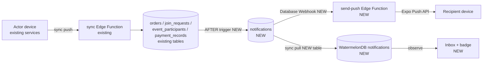

# Notifications Module — Specification

## 📝 TLDR
Today Evolync has no notification mechanism at all: an organization owner learns about a new order, a pending join request or a student's "attending" RSVP only by opening the right screen, and a student learns about a new payment entry or an event they were added to the same way. This spec proposes a new `notifications` module: notifications are **generated server-side by Postgres triggers** when the triggering change reaches Supabase, **synced down into WatermelonDB** like every other table (in-app inbox + unread badge, works offline), and **delivered as push notifications** through the Expo Push Service. Five requested notification types ship first; seven more are catalogued below as recommended extensions.

## 📝 Resolved assumptions (autonomous defaults)

| # | Question | Applied default | Rationale |
|---|----------|-----------------|-----------|
| Q1 | One spec or split in-app inbox and push delivery into two specs? | One spec, two independently shippable phases: inbox first (Phase 1–2), push second (Phase 3). | Push depends on the inbox table (it is the delivery queue); the inbox alone is useful and needs no credentials. |
| Q2 | Where are notifications created — client services or the server? | Server: `AFTER INSERT/UPDATE` Postgres triggers (`security definer`). | Offline-first: a change made offline reaches Supabase only via sync; the client cannot write rows for *other* users through the user-scoped sync filters; triggers also catch every write path (sync, RPC, dashboard). |
| Q3 | Who is the "school owner" recipient? | The organization owner (`organizations.owner_id`) of the school's organization. | It is the only privileged role the sync endpoint and RLS recognise today (`is_org_owner`); there are no per-school instructor accounts yet. |
| Q4 | Push provider? | Expo Push Service (`exp.host`) via `expo-notifications`, sent by a new `send-push` Edge Function invoked from a Database Webhook on `notifications` insert. | Managed Expo workflow + `expo-dev-client` already present; no extra vendor. Needs an EAS `projectId` and FCM/APNs credentials configured once (operational, reversible). |
| Q5 | Per-type notification preferences in v1? | No — one global "Push notifications" switch in Settings plus the OS-level permission. Per-type toggles deferred. | Smallest surface; a `notification_preferences` table can be added later without changing the event contract. |
| Q6 | Include the additional notification types proposed below (E1–E7) in this delivery? | No — only the five requested types (N1–N5) are in scope; E1–E7 are listed as a ready catalogue, each a one-trigger addition. | User asked for a proposal, not for scope; every extension reuses the same pipeline. E1 (order ready for pickup) is recommended as the first follow-up because PRD US-005 already requires it. |
| Q7 | Notification text language? | Rows store `type` + structured `payload`; the in-app inbox renders text client-side with `t()`. Push text is rendered server-side in the locale captured when the device registers its push token (`pl`/`en`, fallback `en`). | Keeps i18n in the client for the inbox; the push token is the only server-side place that knows the device locale. |
| Q8 | Retention? | Pull only notifications from the last 90 days on first sync; no server-side purge in v1. | Bounded first-sync size without a cron job; a purge job can be added later. |

## 📝 Problem Statement
- PRD US-002 says the instructor should "receive notifications about new registrations"; PRD US-005 says an order status change "generates a notification for the student". Neither exists — there is no `notifications` table, no `expo-notifications` dependency and no push token storage (searched `src/`, `supabase/`, `package.json`).
- Owners must poll three screens (orders, students/join requests, event participants) to notice student actions. Students must poll payments and events.
- Because the app is offline-first, a naive "notify in the client service after mutation" approach would fire on the actor's device, not the recipient's, and would miss changes that sync later.

## 📝 Proposed Solution

### Notification catalogue — requested (in scope)

| Id | Recipient | Trigger (server-side) | Example text (en) |
|---|---|---|---|
| N1 | Owner | `orders` INSERT | "New order from {studentName} ({itemCount} items)" |
| N2 | Owner | `school_join_requests` INSERT with `status = 'pending'` | "{displayName} wants to join {schoolName}" |
| N3 | Owner | `event_participants` INSERT/UPDATE where `status` becomes `attending` and `status_changed_by` = the participant's own `user_id` (i.e. the student RSVP'd, not the instructor) | "{studentName} is attending {eventName}" |
| N4 | Student | `payment_records` INSERT for a member with a non-null `user_id` | "New payment: {amount} {currency} for {periodLabel}" |
| N5 | Student | `event_participants` INSERT where `status_changed_by` is null or ≠ the participant's `user_id` (instructor added them — whitelist or approval flow) | "You've been added to {eventName} on {startDate}" |

### Recommended extensions (catalogue, out of scope for this delivery)

| Id | Recipient | Trigger | Why |
|---|---|---|---|
| E1 | Student | `orders.status` → `ready_for_pickup` (optionally every status change) | Required by PRD US-005; highest value follow-up. |
| E2 | Student | `school_members.status` `pending` → `active` (join approved) / `school_join_requests.status` → `rejected` | Closes the loop on N2; today the student has no signal they were accepted. |
| E3 | Student | `events.status` → `cancelled`, or `start_date`/`address` changed, for events they participate in | Prevents students showing up to a cancelled/moved event. |
| E4 | Student | `payment_records.status` → `paid` on UPDATE | Confirmation that the instructor recorded their cash payment (PRD US-004). |
| E5 | Owner | `event_participants.status` `attending` → `absent` by the student | Counterpart of N3 — owner learns about withdrawals. |
| E6 | Student | `school_members.current_rank_id` changed | Celebrates a grading promotion. |
| E7 | Both | Scheduled reminders: event starts tomorrow; payment still `pending` after `period_end` | Needs a scheduled job (`pg_cron`); separate design for timing and throttling. |

Out of catalogue on purpose: school-wide announcements (PRD mentions them, but they are an authored-content feature, not an event notification — separate spec) and notifications for `organization`/`school`-visibility events the student was not explicitly added to (would notify the whole school on every event; can be E8 once per-type preferences exist).

### Alternatives considered
- **Client-side generation in services** — rejected: fires on the actor's device, cannot write rows for other users through the user-scoped sync filters, and misses writes that do not go through that service.
- **Supabase Realtime subscriptions** — rejected as the primary mechanism: requires the app to be open and online, and bypasses the WatermelonDB-only read rule. Push covers the "app closed" case.
- **Local-only notifications computed from synced data diff** — rejected: the recipient's device only sees the change after its own sync, so there is no timely alert, and the diff logic would be duplicated per type.

## 📝 Architecture

Takeaway: existing modules are untouched on the client — all generation happens at the database boundary, so every write path (sync, RPC, dashboard edits) produces exactly one notification.

- **New client module** `src/modules/notifications/` (standard structure: `components/`, `hooks/`, `repositories/NotificationRepository.ts`, `services/notificationService.ts`, `services/pushRegistrationService.ts`, `types/`, `database/schema.ts`, `index.ts`). It imports only from `core`; no other module imports it except the app shell (badge in the header) and `settings` (push toggle) through the barrel.
- **Server**: one migration with the `notifications` and `push_tokens` tables, a helper `notify(recipient uuid, type text, payload jsonb, entity_type text, entity_id uuid)` (`security definer`), and one trigger function per source table. Trigger logic resolves recipients:
  - Owner: `schools.organization_id → organizations.owner_id`.
  - Student: `school_members.user_id` (skip when null — offline members have no account).
  - Never notify the actor: skip when the recipient equals `status_changed_by` / the order's own member user.
- **Sync**: both `sync-organization.ts` and `sync-user.ts` pull `notifications where recipient_id = userId and updated_at > lastPulledAt` (first sync: `created_at > now() - 90 days`), and accept pushed **updates** to `read_at` only, for rows owned by the caller. Creates/deletes from the client are ignored.
- **Push**: `send-push` Edge Function receives the webhook payload, loads the recipient's active `push_tokens`, renders title/body from a small server-side template table keyed by `type` + `locale`, and calls `https://exp.host/--/api/v2/push/send`. Tokens answered with `DeviceNotRegistered` are soft-deleted. Push failure never affects the inbox row.
- **Deep links**: push `data` carries `{ notificationId, type, entityType, entityId, schoolId }`; tapping opens the matching Expo Router route (owner: `organization/orders`, the school's join-requests screen, `organization/events/{id}`; student: `user/payments`, `user/events`) and marks the notification read.

## 📝 Data Model

**Supabase — `public.notifications`** (new)

| Column | Type | Notes |
|---|---|---|
| `id` | uuid PK | `gen_random_uuid()` |
| `recipient_id` | uuid → `auth.users` | indexed with `created_at desc` |
| `organization_id` | uuid null | for owner scoping/filters |
| `school_id` | uuid null | context + deep link |
| `type` | text | check in (`order_created`, `join_request_created`, `event_rsvp_attending`, `payment_created`, `event_assigned`) — extended per E-type |
| `entity_type` / `entity_id` | text / uuid | the source row |
| `payload` | jsonb | denormalised display data captured at trigger time (names, amounts, dates) so the inbox renders without joins and survives source deletion |
| `read_at` | timestamptz null | the only client-writable column |
| `created_at`, `updated_at`, `deleted_at` | timestamptz | standard sync columns |

Unique partial index on `(recipient_id, type, entity_id)` where `deleted_at is null` for idempotency (a re-pushed sync batch or an `attending → absent → attending` flip does not create duplicates; N3 re-fire updates `updated_at` and clears `read_at` instead).

RLS: `select` and `update (read_at)` where `recipient_id = auth.uid()`; no client `insert`/`delete`.

**Supabase — `public.push_tokens`** (new): `id`, `user_id`, `token` (unique), `platform` (`ios`/`android`), `locale`, `enabled` bool, timestamps, `deleted_at`. RLS: owner-only CRUD. Written directly from the client via a new allowed RPC `register_push_token(token, platform, locale)` / `disable_push_token(token)` — a deliberate addition to the "allowed direct Supabase calls" list in `CLAUDE.md` because a device token is device state, not offline business data, and is meaningless offline.

**WatermelonDB** — schema version 18 → 19, new table `notifications` (`recipient_id`, `school_id`, `type`, `entity_type`, `entity_id`, `payload` as JSON string, `read_at`, `created_at`, `updated_at`, `deleted_at`), model `Notification` in `src/database/models/`. `push_tokens` is not synced.

Sensitive data: `payload` holds names/amounts already visible to the recipient through normal sync — no new exposure. Push text appears on lock screens; amounts are included only in N4 (acceptable: it is the student's own payment). No secrets in payloads.

## 📝 API Contracts
- `register_push_token(p_token text, p_platform text, p_locale text) returns void` — upsert by token, sets `user_id = auth.uid()`, `enabled = true`.
- `disable_push_token(p_token text) returns void` — on logout and when the Settings toggle is turned off.
- Sync protocol: new table key `notifications` in pull `changes`; push accepts only `updated` entries whose sole changed field is `read_at`.
- Push message `data`: `{ notificationId: string, type: NotificationType, entityType: string, entityId: string, schoolId?: string }`.

## 📝 UI/UX
- **Bell icon with unread count** in the header of both dashboards (`app/organization/dashboard.tsx`, `app/user/dashboard.tsx`); count = `observeUnreadCount()`.
- **Inbox screen** (`app/notifications/index.tsx`, shared by both roles): list of `BaseCard` rows — type icon (Lucide), localized title from `t(\`notifications.${type}.title\`, payload)`, relative time, unread dot. Tap → mark read + navigate to the deep-link target. Header action "Mark all as read". Empty state: "No notifications yet". Offline: list still renders from WatermelonDB.
- **Settings**: "Push notifications" switch in `app/user/settings.tsx` (and the owner settings entry), reflecting OS permission; turning on requests permission the first time.
- **Permission prompt timing**: not at app start — on first dashboard visit after login, with a one-line rationale sheet, so the OS prompt is not wasted.
- Translations: new keys under `notifications.*` in both `en.json` and `pl.json` (check for duplicates first, per `CLAUDE.md`).

Mockups: skipped — no browser provider CLI or test-env descriptor available in this environment.

## 📝 Edge Cases & Failure Scenarios

| Scenario | Behavior |
|---|---|
| Student places an order offline | No notification until the order syncs; trigger fires on arrival — owner gets it then (expected for offline-first). |
| Instructor approves a join request and, in the same flow, adds the student to 6 cycles and 3 events | 9 inbox rows (N4×6, N5×3). `send-push` coalesces >3 notifications to the same recipient within 60 s into one push "You have N new notifications". |
| Offline school member (`user_id` null) gets a payment record | No recipient → no notification. |
| Owner is also a member of another school | Sync runs in organization mode only (current `index.ts` behavior); notifications are pulled in both sync modes by `recipient_id`, so the owner still receives student-type notifications. |
| Student toggles `attending → absent → attending` | Idempotency index: one row, re-surfaced as unread with refreshed `updated_at`; no duplicate push within 10 min. |
| Instructor marks a student `attending` | `status_changed_by` ≠ participant's user → N3 does not fire (owner is the actor). |
| Source row later soft-deleted (order cancelled, participant removed) | Notification stays (historical); deep link opens the list screen with a "no longer available" toast if the entity is gone. |
| Push token expired / app uninstalled | Expo returns `DeviceNotRegistered` → token soft-deleted; inbox unaffected. |
| Expo Push API down / missing credentials | `send-push` logs and returns 200 to the webhook (no retry storm); inbox is the source of truth. |
| User logs out on a shared device | `disable_push_token` called before sign-out; WatermelonDB reset already clears local rows. |
| Trigger error | Trigger body wraps `notify()` in `exception when others then raise warning` — a notification failure must never roll back the student's order/RSVP/payment write. |

## 📝 Risks & Impact Review
- **New server contract (hard-ish to reverse):** two tables, one RPC pair, a sync table key, and triggers on four existing tables. Rollback = drop triggers (source tables unaffected) and stop pulling `notifications`; old app versions ignore the unknown sync key only if the client tolerates unknown tables — verify WatermelonDB `synchronize` behavior before shipping the server side ahead of the client (ship client schema first, or gate the pull on a client-sent `schemaVersion`).
- **Rule change:** `register_push_token`/`disable_push_token` extend the "allowed direct Supabase calls" list in `CLAUDE.md`; the spec's implementation must update that list explicitly.
- **Native dependency:** `expo-notifications` requires a new dev-client/EAS build and FCM (`google-services.json`) + APNs key setup — an operational prerequisite for Phase 3 only.
- **Trigger cost:** one extra insert per source row; bulk cycle creation for a 200-student school creates 200 notification rows + webhook calls. Acceptable; webhook → `send-push` batches up to 100 messages per Expo request.
- **Recipient model:** owner-only recipients encode today's single-instructor assumption; when multi-instructor roles arrive, recipient resolution in `notify` triggers must be revisited (single helper function keeps that change local).

## 📋 Phasing
- **Phase 1 — Server generation + sync (no UI change):** tables, `notify()` helper, triggers N1–N5, sync pull/push in both sync modes, WatermelonDB schema 19 + model + repository. Shippable: data accumulates, nothing visible yet.
- **Phase 2 — In-app inbox:** module UI, bell badge on both dashboards, inbox screen, mark-read, deep links, translations. Shippable on its own without push.
- **Phase 3 — Push delivery:** `expo-notifications`, token registration RPCs, `send-push` Edge Function + Database Webhook, Settings toggle, permission prompt, notification-tap routing.
- **Phase 4 (follow-up specs/PRs):** E1–E7 as needed, starting with E1.

## 📋 Implementation Plan

**Phase 1**
1. Supabase migration: `notifications` table, indexes, unique idempotency index, RLS. Test: as student A, `select` returns only A's rows; `insert` is denied.
2. Same migration: `notify()` helper + triggers for N1–N5 with recipient resolution and the never-notify-the-actor rule, exception-safe. Test (SQL): insert an order as a member → one owner row; student RSVP `attending` → one owner row; instructor RSVP → none; whitelist insert → one student row; payment record for offline member → none.
3. Sync: pull `notifications` in `sync-organization.ts` and `sync-user.ts` by `recipient_id` (90-day window on first pull); accept `read_at`-only updates for owned rows. Test: second user's notifications never appear in a pull; pushing a changed `type` is ignored.
4. WatermelonDB: `notifications` table schema (v19) + migration, `Notification` model, `NotificationRepository` (`observeByRecipient`, `observeUnreadCount`, `markRead`, `markAllRead`, all with `Q.where("deleted_at", null)`). Test: `npm run typecheck`; repository unit test for unread count.

**Phase 2**
5. `notifications` module scaffold + types (`NotificationType`, payload DTOs) and `notificationService.markRead/markAllRead` calling `sync().catch(console.error)`.
6. `NotificationBell` component (unread badge) in both dashboard headers. Test: badge count updates reactively when a notification row is inserted locally.
7. Inbox screen `app/notifications/index.tsx` with `BaseCard` rows, empty state, "mark all read", deep-link navigation per type. Test: tapping each of N1–N5 opens the right screen and clears the unread dot.
8. Translations `notifications.*` in `en.json` + `pl.json` (duplicate check first).

**Phase 3**
9. Add `expo-notifications`, app config (EAS `projectId`, Android channel), `pushRegistrationService` (permission request, token fetch, `register_push_token` RPC with locale from `expo-localization`); update `CLAUDE.md` allowed-calls list. Test: on a dev build, token row appears for the user.
10. `send-push` Edge Function: load enabled tokens, render localized title/body, coalesce bursts, call Expo Push API, soft-delete `DeviceNotRegistered` tokens. Test: function unit test with mocked fetch for single, coalesced and invalid-token cases.
11. Database Webhook on `notifications` INSERT → `send-push` (migration or documented dashboard step).
12. Settings "Push notifications" toggle + first-dashboard permission rationale sheet; `disable_push_token` on logout. Test: toggling off stops pushes; logout disables the device token.
13. Notification-tap handler (`addNotificationResponseReceivedListener` + cold-start `getLastNotificationResponseAsync`) routing via the same deep-link map as the inbox, marking read.
