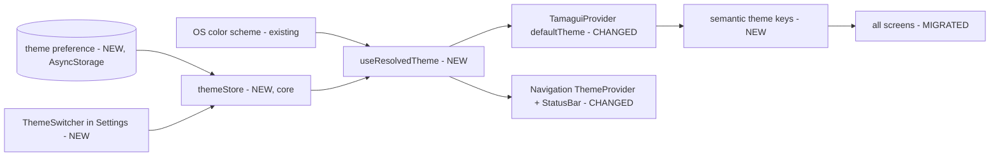

# Dark Mode — Specification

## 📝 TLDR
Every user (instructor and student) currently sees a light-only app, even on a phone set to dark mode — the theme is hard-wired to `light` and most screens paint with fixed light-palette colors. This spec proposes an **Appearance** setting (System / Light / Dark, default System) stored per device like the language preference, backed by semantic theme colors that flip between light and dark. It closes the future-spec candidate recorded in `2026-09-27-settings-module.md` ("Theme stays light-only for now; dark mode is a real, wanted future feature").

## 📝 Problem Statement
- Instructors work in gyms, halls and evening classes; a bright-white UI in a dim room is uncomfortable and drains OLED batteries. Dark mode is an OS-level expectation on iOS/Android.
- `app.json` already declares `"userInterfaceStyle": "automatic"` and `tamagui.config.ts` already defines a `dark` theme, but neither is used:
  - `app/_layout.tsx` mounts `<TamaguiProvider defaultTheme="light">` and React Navigation's `DefaultTheme`, and paints the root `View` and `Stack` `contentStyle` with a literal `#F8FAFC`. `app/techniques/threed/[sequenceId]/_layout.tsx` repeats the literal.
  - Screens color text and surfaces with **static palette tokens** that do not change per theme. Measured on `origin/main` (2026-10-02) across `app/` + `src/` `.tsx`: `$softGrayDark` ×87, `$inkBlack` ×64, `$softGray` ×57, `$softGrayLight` ×52, `$pearlWhite` ×34, `$inkBlackLight` ×27, `$softGrayLighter` ×24, `*Lighter` tint backgrounds ×~55, plus 67 hex literals in 29 files and 10 `"white"`/`"black"` literals. Only ~90 usages are theme-aware (`$background`, `$color`, `$borderColor`, `$grayN`).
- Consequence: flipping the Tamagui theme alone would render `$inkBlack` text on a `#0F172A` background — unreadable. Dark mode is mostly a **color-migration** problem, not a toggle problem.
- Found during research (fixed as part of migration): `$softGrayBark` is used 4× in `app/user/orders/[orderId].tsx` and `app/school/[schoolId]/orders/[orderId].tsx` but is not a defined token (typo of `$softGrayDark`).
- The dead Expo-template `Themed.tsx`/`useColorScheme` cluster was already deleted (`2026-09-27-core-module.md`) — there is no prior implementation to build on.

## 📝 Resolved assumptions (autonomous defaults)
| # | Question | Applied default | Rationale |
|---|---|---|---|
| Q1 | Which choices does the user get, and what is the default? | **System / Light / Dark, default System.** | Matches platform conventions and `app.json`'s existing `automatic`. Default is one constant; the setting only ships after migration (Phase 3), so nobody sees a half-dark app. Reversible. |
| Q2 | Where is the preference stored? | **Per device, in AsyncStorage/localStorage** (key `@evolync:theme`), same as language. | No schema, no sync, no Supabase change; works offline. Moving it to the synced profile later is additive. Reversible. |
| Q3 | Does the 3D canvas follow the theme? | **No.** The 3D viewer/editor keep their current dark (`#000`) canvas; only surrounding panels, sheets and controls are themed. | The canvas is already dark; re-lighting the scene and model materials is out of scope and risks the 60 FPS target. Reversible. |
| Q4 | Brand accents (imperial red, jade, gold) in dark? | **Keep hues; theme only the tinted backgrounds and on-tint text** via semantic keys. | Least visual churn for the brand; `*Lighter` pastel tints are the parts that break in dark. Reversible per key. |
| Q5 | Split into separate specs (color migration vs. setting)? | **No — one spec, phased.** | The setting is not usable without the migration and the migration has no user value without the setting; they are not independently deployable capabilities. Phases 1–2 are invisible in light mode, so each still ships safely. |
| Q6 | Enforce "no static colors" going forward? | **Yes, a lightweight script check** added to the validation gate after migration. | Without it, new screens re-introduce `$inkBlack`; cheap and removable. Reversible. |

## 📝 Proposed Solution
1. **Semantic theme keys.** Add a small set of named keys to both `light` and `dark` themes in `tamagui.config.ts`. Light values equal today's palette exactly, so the migration is pixel-identical in light mode.
2. **Migrate screens** from static palette tokens/literals to semantic keys (mechanical, module by module).
3. **Theme preference** (`system | light | dark`) in a tiny Zustand store in `src/core/theme/`, persisted with the same platform-safe storage wrapper i18n uses, resolved against the OS color scheme (`useColorScheme` from `react-native`).
4. **Root wiring:** `TamaguiProvider defaultTheme={resolved}`, React Navigation `DarkTheme`/`DefaultTheme` with our background/text colors, `expo-status-bar` style, and no hardcoded `#F8FAFC`.
5. **Appearance picker** in `app/user/settings.tsx`, beside `LanguageSwitcher`, same `list` presentation.

**Alternatives considered**
- *Flip `defaultTheme` only* — rejected: ~600 static color usages stay light (see Problem Statement).
- *Redefine the palette tokens per theme* (make `$inkBlack` mean "light" in dark) — rejected: tokens are theme-independent in Tamagui, and a token named `inkBlack` rendering white is a trap for every future editor.
- *Use the default `config.themes.dark` subthemes (`$color1–12`) directly* — rejected as the primary API: numeric scales don't communicate intent (`$color11` vs "secondary text") and don't map onto the brand palette. Used as fallback only.
- *Store in the synced user profile* — deferred (Q2): needs schema + migration + sync for little gain; theme is a device/environment preference.

## 📝 Architecture
- **Primary home: `core`** — `src/core/theme/` (store, `useResolvedTheme`, persistence) next to `src/core/i18n/`, and `ThemeSwitcher` in `src/core/components/` next to `LanguageSwitcher`. `core` imports no other module, per CLAUDE.md.
- **Shared storage helper:** the platform-safe `storage` wrapper currently private to `src/core/i18n/config.ts` is extracted to `src/core/storage.ts` and reused by both i18n and theme (no behavior change for language).
- **Every module's UI is touched** by the color migration (attendance, auth, core, dashboard, events, grading, inventory, notifications, orders, organization, payments, school, students, tags, techniques, threed) — styling props only; no repository, service, sync or schema changes.

Takeaway: one resolved value at the root drives everything; screens only consume semantic keys and never know which theme is active.

### Semantic keys (initial set)
| Key | Light (today's value) | Dark | Replaces |
|---|---|---|---|
| `background` | `#F8FAFC` | `#0F172A` | root literals, `$pearlWhite` as page bg |
| `surface` | `#FFFFFF` | `#1E293B` | `$pearlWhiteLight`, `"white"` card/sheet bg |
| `textPrimary` | `#0F172A` | `#F8FAFC` | `$inkBlack`, `$inkBlackLight` |
| `textSecondary` | `#64748B` | `#CBD5E1` | `$softGrayDark` |
| `textMuted` | `#94A3B8` | `#94A3B8` | `$softGray` |
| `borderSubtle` | `#E2E8F0` | `#334155` | `$softGrayLighter`, `$softGrayLight` as border |
| `successSurface` / `successText` | `#d6f1e8` / `#047857` | `#064E3B` / `#6EE7B7` | `$jadeGreenLighter` / `$jadeGreenDark` |
| `dangerSurface` / `dangerText` | `#fed1d1` / `#B91C1C` | `#450A0A` / `#FCA5A5` | `$imperialRedLighter` / `$imperialRedDark` |
| `warningSurface` / `warningText` | `#fbefd2` / `#D97706` | `#451A03` / `#FCD34D` | `$chineseGoldLighter` / `$chineseGoldDark` |
| `infoSurface` / `infoText` | `#cffafe` / `#0E7490` | `#164E63` / `#67E8F9` | `$chineseCyanLighter`, `$darkBlueLighter` |

Dark values are a starting point; the implementer adjusts them to meet WCAG AA (4.5:1 for body text) and records the final values in this table. Solid accent fills (`$imperialRed`, `$jadeGreen`, `$chineseGold` buttons/badges with white text) stay as-is.

## 📝 Data Model
No database or Supabase change. One new device-local key: `@evolync:theme` = `"system" | "light" | "dark"`; missing/invalid → `"system"`.

## 📝 API Contracts
Internal only (`@/core/theme` barrel):
- `useThemePreference(): { preference, setPreference(p) }` — `setPreference` updates the store synchronously and persists fire-and-forget.
- `useResolvedTheme(): "light" | "dark"`.
- `loadThemePreference(): Promise<void>` — called during app bootstrap before `SplashScreen.hideAsync()`.

## 📝 UI/UX
- **Settings → Appearance** section below Language: three options (System, Light, Dark), active one highlighted the same way `LanguageSwitcher` highlights the active language. The change applies instantly without navigation reset (same re-render-not-remount rule the settings spec established for language).
- System option follows the OS live (switching OS theme while the app is open updates it).
- Status bar icons, navigation header/backgrounds, sheets, toasts, dialogs and the sync status bar all follow the theme.
- 3D viewer/editor: canvas unchanged (Q3); panels, sliders and sheets themed.
- New translation keys (verified absent in `en.json` on 2026-10-02; re-check before adding, both `en.json` and `pl.json`): `settingsAppearance` ("Appearance"/"Wygląd"), `themeSystem` ("System"/"Systemowy"), `themeLight` ("Light"/"Jasny"), `themeDark` ("Dark"/"Ciemny").
- Mockups: none rendered (no test-env descriptor in the repo; see PR).

## 📝 Edge Cases & Failure Scenarios
| Scenario | Behavior |
|---|---|
| Cold start with Dark saved | Preference loaded before splash hides → no white flash. Native splash itself stays light (out of scope; noted). |
| Storage read fails / corrupt value | Fall back to `system`; no error shown. |
| Web, `localStorage` blocked | Same fallback; setting works for the session only. |
| OS reports `null` color scheme | Treated as `light`. |
| A screen missed by migration | Shows light-colored text/surfaces in dark — caught by the Phase 4 check and the manual dark-mode QA pass per module. |
| Third-party components (date pickers, native alerts) | Follow OS scheme, not the in-app override; acceptable, documented. |
| User picks Dark while OS is Light | In-app UI dark; native dialogs may stay light (platform limit). |

## 📝 Risks & Impact Review
- **Broad diff, low logical risk.** The migration touches styling in ~100+ files but no data flow. Light-mode output must stay pixel-identical — enforced by light values equal to current palette and by screenshot comparison per module.
- **Merge-conflict exposure:** module-sized PRs reduce collisions with parallel feature work.
- **Contrast** of brand accents on dark backgrounds is the main design risk; handled through the `*Text` semantic keys rather than ad-hoc overrides.
- **Reversibility:** setting the default to `light` and hiding `ThemeSwitcher` fully reverts the user-facing change; semantic keys remain harmless.
- No protected surfaces in `BACKWARD_COMPATIBILITY.md` are affected (no schema, sync, API or storage-of-record change).

## 📋 Phasing
- **Phase 1 — Foundation (invisible):** semantic keys, theme store/hook, root wiring still forced to `light`.
- **Phase 2 — Color migration (invisible in light):** module by module, replace static tokens/literals with semantic keys; fix `$softGrayBark`.
- **Phase 3 — Ship the setting:** enable resolved theme at root, Appearance picker, translations.
- **Phase 4 — Guardrail:** static-color check in the validation gate.

## 📋 Implementation Plan
**Phase 1 — Foundation**
1. Extract the platform-safe storage wrapper from `src/core/i18n/config.ts` to `src/core/storage.ts`; i18n imports it. Verify language persistence unchanged.
2. Add semantic keys (table above) to `light` and `dark` in `tamagui.config.ts`; typecheck.
3. Add `src/core/theme/` (store, `loadThemePreference`, `useThemePreference`, `useResolvedTheme`) + unit tests for resolution and invalid-value fallback.
4. In `app/_layout.tsx` and `app/techniques/threed/[sequenceId]/_layout.tsx`, replace `#F8FAFC` literals with theme values, wire navigation theme + `StatusBar`, await `loadThemePreference()` before hiding splash — with the resolved theme still hard-forced to `light`.

**Phase 2 — Migration** (one step per module group; each step: replace tokens, then compare light screenshots before/after and toggle a local dev override to dark to check readability)
5. `core` components (Header, BaseCard, SyncStatusBar, sheets, toasts, form fields).
6. `auth` + `settings` screens (`app/user/*`).
7. `dashboard`, `notifications`.
8. `school`, `students`, `organization`.
9. `attendance`, `events`, `grading`.
10. `payments`, `orders` (fix `$softGrayBark` → `textSecondary`), `inventory`.
11. `techniques`, `tags`, and `threed` panels and sheets (canvas excluded).

**Phase 3 — Setting**
12. Add `ThemeSwitcher` (`list` variant) to `src/core/components/`, render in `app/user/settings.tsx` under Language; add the 4 translation keys to `en.json` and `pl.json`.
13. Remove the `light` force; default `system`. Manual QA: every top-level screen in Light, Dark and System (OS toggled live), iOS + Android + web.

**Phase 4 — Guardrail**
14. Add `scripts/check-theme-colors` (fails on `color=`/`backgroundColor=`/`borderColor=` using the migrated static tokens or hex literals outside an allowlist — 3D canvas, brand fills) and append it to the validation commands.
