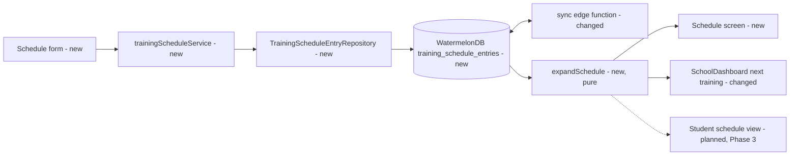

# School Training Schedule

## 📝 TLDR
Instructors cannot record *when* a school trains today: `training_sessions` only exist after the fact, created when attendance is marked. This spec proposes a per-school **training schedule** where an instructor defines trainings as **recurring** (weekly, e.g. Mon + Thu 18:00; or monthly, e.g. first Saturday 10:00) or **one-off** (specific dates, e.g. the next month's plan entered in one go). The app derives upcoming trainings from those rules offline and shows them on a schedule screen and as "next training" on the school dashboard.

## Resolved assumptions (autonomous defaults)
| # | Question | Applied default | Why | Confirm? |
|---|----------|-----------------|-----|----------|
| Q1 | Should scheduled trainings auto-create attendance `training_sessions`? | **No.** The schedule is a plan; attendance keeps its current create-on-mark flow. | Avoids empty sessions for cancelled trainings and leaves the attendance module untouched; linking later is additive. | reversible |
| Q2 | One rule with a weekday list, or one row per slot? | **One row per slot** (Mon 18:00 and Thu 18:00 are two rows). The form still lets the instructor tick several weekdays at once. | Lets each weekday have its own time/duration; no array columns in WatermelonDB. | reversible |
| Q3 | What does "monthly" mean? | **Nth weekday of the month** (1st–4th or last, e.g. "first Saturday"). | Matches how clubs schedule monthly seminars; day-of-month can be added as another `kind` later without migration of existing rows. | reversible |
| Q4 | Can students see the schedule? | **Yes, read-only, delivered in Phase 3.** Phases 1–2 are instructor-only. | Smallest first slice; RLS already grants read to members so Phase 3 is UI + student sync only. | reversible |
| Q5 | Cancel a single occurrence of a recurring training (holiday)? | **Deferred.** Workaround: set `valid_until`, or delete the rule and re-add it. | An exceptions table is additive later; keeps v1 small. | reversible |
| Q6 | Time zones? | **Wall-clock time, no zone.** `start_time` is a local `"HH:mm"` string and one-off dates are calendar days. | Schools have no stored timezone (see attendance spec, fix #5); wall-clock time is what instructors mean and is DST-safe. | reversible |
| Q7 | Who can edit? | **Organization owner only**, the same guard as school settings (`useRequireOrganizationOwner`). | Matches existing school-level permissions. | reversible |
| Q8 | Split into several specs? | **No.** Schedule definition and its display ship one capability; the student view is a separate phase in this spec. | Neither half is useful alone. | reversible |

## 📝 Problem Statement
- Schools train on different rhythms: one trains twice a week, another once a week; one keeps a fixed weekly cycle, another plans individual dates month by month. The app has nowhere to store any of these.
- `training_sessions` (`src/modules/attendance/`) stores only past trainings with attendance records. It allows one per school per day (`unique_school_date`), and the app creates it when the instructor marks attendance. It cannot express a future plan or a recurrence.
- Without a schedule the dashboard cannot say when the next training is, and instructors fall back to external calendars or chat messages.

## 📝 Proposed Solution
A new offline-first entity, `training_schedule_entries`, owned by the `attendance` module (which already owns the "training" concept). Each row is one rule of one of three kinds:

| `kind` | Meaning | Required fields |
|---|---|---|
| `weekly` | Every week on `weekday` | `weekday`, `start_time` |
| `monthly` | Every month on the `week_of_month`-th `weekday` (`-1` = last) | `weekday`, `week_of_month`, `start_time` |
| `one_off` | A single training on `date` | `date`, `start_time` |

Recurring rules can be bounded with optional `valid_from` / `valid_until`. A pure function `expandSchedule(entries, from, to)` turns rules into concrete, sorted occurrences for a date range. Occurrences are **computed, never stored**, so editing a rule affects every future occurrence immediately and no background job is needed. The function works fully offline.

**Alternatives rejected**
- *Materialize occurrences as rows* (e.g. pre-create `training_sessions`): needs a horizon, regeneration on edit, and cleanup of orphans; it would also break `unique_school_date` for schools with two trainings on one day. Rejected for v1 (Q1).
- *iCal RRULE string*: flexible but opaque to validate and edit in a mobile form, and it adds a parsing dependency. The three kinds cover the stated needs. An RRULE `kind` can be added later if needed.

## 📝 Architecture
- **Primary module:** `attendance`. New model, repository, service, hooks, validation and `expandSchedule` helper there, all exported via its barrel.
- **Consumers:** the `dashboard` module reads `useNextTraining(schoolId)` from `@/modules/attendance` (it already imports `useTodaySession` the same way). Phase 3 adds a student screen that reads `useTrainingSchedule`.
- **Sync:** Phase 1 adds the table to `supabase/functions/sync/sync-organization.ts` (push + pull for owners). Phase 3 adds it to `sync-user.ts` (pull for students of the school).
- **No change** to `training_sessions`, attendance flows or the `events` module. Events stay one-off happenings with participants and pricing, and the schedule is about regular trainings.


All new logic stays in `attendance`. The only changes to existing code are the sync tables, the schema version and one dashboard line.

## 📝 Data Model
**WatermelonDB:** schema version `19 → 20`, `createTable` migration in `src/database/migrations.ts`. Table schema lives in `src/modules/attendance/database/schema.ts`. Model is `src/database/models/TrainingScheduleEntry.ts` (`belongs_to` schools).

| Column | Type | Notes |
|---|---|---|
| `school_id` | string, indexed | |
| `kind` | string | `'weekly' \| 'monthly' \| 'one_off'` |
| `weekday` | number, optional | 0 = Sunday … 6 = Saturday (JS `getDay()`); required for `weekly`/`monthly` |
| `week_of_month` | number, optional | 1–4 or -1 (last); `monthly` only |
| `date` | number, optional | `one_off` only. UTC-midnight timestamp of the calendar day, the same convention as `training_sessions.date` |
| `start_time` | string | `"HH:mm"`, 24 h, wall-clock |
| `duration_minutes` | number, optional | 15–600 |
| `valid_from` | number, optional | recurring only; UTC-midnight day |
| `valid_until` | number, optional | recurring only; inclusive |
| `notes` | string, optional | e.g. "advanced group", hall name; max 500 chars |
| `created_at` / `updated_at` / `deleted_at` | number | standard soft-delete |

**Supabase:** new migration `supabase/migrations/20261003000000_training_schedule_entries.sql` with a `public.training_schedule_entries` table that mirrors the columns. It adds `check` constraints per `kind` (e.g. `kind <> 'monthly' or (weekday is not null and week_of_month is not null)`), `school_id` FK → `schools(id)`, and an index on `(school_id, updated_at)` for sync. RLS mirrors `training_sessions` in `20260122000000_attendance_sessions.sql`: *Org owner can manage*, *School members can view*. No PII is stored.

## 📝 API Contracts
Service `src/modules/attendance/services/trainingScheduleService.ts` (each mutation runs `database.write()` and then `sync().catch(...)`):

```ts
type ScheduleKind = "weekly" | "monthly" | "one_off";

createScheduleEntries(schoolId: string, input: ScheduleFormValues): Promise<TrainingScheduleEntry[]>
//  weekly with weekdays [1,4] → 2 rows; one_off with dates [d1,d2,d3] → 3 rows; one batch, atomic
updateScheduleEntry(id: string, patch: UpdateScheduleEntryDto): Promise<TrainingScheduleEntry>
deleteScheduleEntry(id: string): Promise<void>            // soft delete

// src/modules/attendance/types/helpers.ts — pure, no DB (add-types convention)
expandSchedule(entries: ScheduleEntryLike[], from: Date, to: Date): TrainingOccurrence[]
type TrainingOccurrence = { entryId: string; day: string /* YYYY-MM-DD */; startTime: string; durationMinutes?: number; kind: ScheduleKind; notes?: string }
```

Validation (`src/modules/attendance/validation/trainingScheduleSchema.ts`) is a Zod discriminated union on `kind`. Rules: `weekdays` must be non-empty for `weekly`; `week_of_month` must be in {1,2,3,4,-1} for `monthly`; `dates` must be non-empty and contain no duplicates for `one_off`; `start_time` must match `/^([01]\d|2[0-3]):[0-5]\d$/`; `valid_until >= valid_from`. Error messages are i18n keys.

Hooks: `useTrainingSchedule(schoolId)` observes the entries, `useUpcomingTrainings(schoolId, days = 28)` expands them, and `useNextTraining(schoolId)` returns the first occurrence at or after now.

## 📝 UI/UX
New routes: `app/school/[schoolId]/schedule/index.tsx` and `app/school/[schoolId]/schedule/edit.tsx` (`?entryId=` for edit). Both are guarded by `useRequireOrganizationOwner`.

- **Schedule screen** has two sections.
  - **Upcoming** lists the next 4 weeks of expanded occurrences grouped by week ("Mon 6 Oct · 18:00 · 90 min").
  - **Rules** lists one `BaseCard` per entry ("Every Monday · 18:00", "First Saturday of the month · 10:00", "One-off · Fri 14 Nov · 18:00"). Tapping a card edits it. An "Add training" button opens the form.
  - Empty state: an explanation plus the add button.
- **Form** (React Hook Form + Zod) has a segmented control **Recurring / One-off**.
  - *Recurring* shows a frequency toggle **Weekly / Monthly**.
    - *Weekly* shows weekday chips with multi-select. In edit mode only a single weekday can be selected, because each row is one slot.
    - *Monthly* shows a "which" select (1st, 2nd, 3rd, 4th, last) and a weekday select.
    - Optional fields: start date and end date.
  - *One-off* shows a list of date pickers with "+ Add another date", so a whole next-month plan goes in one save.
  - Shared fields: start time, duration and notes. Delete is available in edit mode and asks for confirmation. Uses `SubmitComponent` with the dirty-flag pattern used by the school settings screen.
- **Entry points:** a "Training schedule" row on `app/school/[schoolId]/settings.tsx`, and a "Next training: Mon 6 Oct, 18:00" line on `SchoolDashboard` that opens the schedule screen. When no rule exists, the line is hidden.
- All strings go through `t()`. Keys are added to `en.json` and `pl.json` after a duplicate check, and weekday/ordinal names reuse existing keys where present.
- Phase 3: students see a read-only version of **Upcoming** from their school view, with no rules section and no edit.

Mockups: none attached. The repo has no `om-prepare-test-env` descriptor, so app screenshots could not be captured.

## 📝 Edge Cases & Failure Scenarios
| Scenario | Behavior |
|---|---|
| "Last Friday" in a month with 5 Fridays | `week_of_month = -1` resolves to the 5th; `4` resolves to the 4th. |
| Two rules land on the same day and time | Both occurrences are listed; no dedupe, since it is a valid if odd setup. |
| Two trainings on one day, then attendance is marked | Unchanged existing limitation: one `training_session` per school per day. Noted, not fixed here. |
| DST change week | No shift. Times are wall-clock strings combined with the calendar day only at display time. |
| `valid_until` in the past | The rule stays listed under Rules and is labeled "Ended"; no future occurrences. |
| One-off date in the past | Shown under Rules as past; never shown in Upcoming. |
| Rule edited offline on two devices | The existing sync last-write-wins per row applies, the same as other tables. |
| Sync fails after save | The local save stands and the UI updates via `.observe()`. Sync retries on the next trigger, as for every other table. |
| Invalid input reaches the service (non-form caller) | Zod throws before any write; nothing is persisted. |
| School soft-deleted | Entries remain but are unreachable through school-scoped queries. No cascade is needed for v1. |

## 📝 Risks & Impact Review
- **Schema (hard to reverse once synced):** there is a new Supabase table and WatermelonDB schema v20. The change is additive only, so no existing table or contract changes. Rollback means dropping the screen and leaving the table unused, or a down-migration before any production data exists.
- **`kind` vocabulary is a stored contract.** Adding kinds later is safe. Renaming or removing one needs a data migration, so the three names are chosen to be stable.
- **Sync function** gains one table in `sync-organization.ts` (Phase 1) and `sync-user.ts` (Phase 3). This follows the existing per-table pattern there, with a low regression surface, but it is deployed server-side together with the migration.
- **Product rule check:** CLAUDE.md's "No sharing training plans with students" refers to 3D technique training plans. A schedule of training *times* is a different thing, so Phase 3 does not conflict with it, but the owner should confirm that reading.
- **Direction calls (not defects):** no attendance linkage (Q1) and no per-occurrence cancellation (Q5) are scope choices, both additive later.

## 📋 Phasing
- **Phase 1 — Data layer.** Table, model, repository, migrations (local and Supabase), RLS, organization sync, validation, service, and `expandSchedule` with unit tests. Nothing visible yet, and the app works unchanged.
- **Phase 2 — Instructor UI.** Schedule screen, form, settings entry point, dashboard "next training", and translations.
- **Phase 3 — Student view.** `sync-user` pull plus a read-only upcoming list in the student's school view.

## 📋 Implementation Plan
**Phase 1**
1. Add `training_schedule_entries` to `src/modules/attendance/database/schema.ts`, bump the schema to v20, add a `createTable` step to `src/database/migrations.ts`, add the `TrainingScheduleEntry` model and register it in `src/database/models/index.ts`. Test: `npm run typecheck`, and the app boots and migrates an existing v19 DB.
2. Add a Supabase migration (table, per-kind `check` constraints, FK, index, RLS mirroring `training_sessions`). Test: apply locally; an owner can insert, a member can select, a non-member is denied.
3. Add the table to `sync-organization.ts` (allowed push tables and pull). Test: run the existing Deno sync tests via `supabase/functions/run-deno-tests.sh` with a new case covering push/pull of an entry.
4. Add `TrainingScheduleEntryRepository` (create/batch-create, update, softDelete, `observeBySchoolId` with `Q.where("deleted_at", null)`, sorted). Test: unit test covering soft-deleted rows being excluded.
5. Add the Zod `trainingScheduleSchema` (discriminated union) and DTO/enum types under `attendance/types`. Test: valid and invalid cases per kind.
6. Add `expandSchedule` (pure) in `attendance/types/helpers.ts`. Test (`npm test`, `src/modules/attendance/__tests__/expandSchedule.test.ts`): weekly Mon+Thu over 4 weeks gives 8 occurrences; "last Friday" in a 5-Friday month; `valid_from`/`valid_until` bounds; a one-off outside the range is excluded; output is sorted by day then time; a DST-crossing range keeps `"18:00"`.
7. Add `trainingScheduleService` (create = one batch, update, delete, each followed by fire-and-forget `sync()`), plus hooks `useTrainingSchedule`, `useUpcomingTrainings` and `useNextTraining`, all exported from `src/modules/attendance/index.ts`. Test: creating weekly `[1,4]` produces 2 rows atomically, and invalid input writes nothing.

**Phase 2**
8. Add translation keys to `en.json` and `pl.json` after a duplicate check. Test: `npm run typecheck` and the locale parity check, if present.
9. Add the form component `TrainingScheduleForm` (segmented kind, weekday chips, monthly selects, one-off date list, time/duration/notes) and the `schedule/edit.tsx` route with the dirty-flag submit. Test: create each kind and edit one; verify the rows and the validation messages.
10. Add the `schedule/index.tsx` screen (Upcoming + Rules, empty state, "Ended" and past labels) and the settings entry row. Test: the rules created in step 9 render, and deleting one removes its occurrences reactively.
11. Add the "Next training" line to `SchoolDashboard` via `useNextTraining`, hidden when there are no rules. Test: the line appears with the correct next occurrence, updates after an edit, and passes `npm run check:theme`.

**Phase 3**
12. Add the table pull to `sync-user.ts`, scoped to the student's schools. Test: Deno sync test confirming a student receives entries only for their own school.
13. Add a read-only upcoming list to the student's school view, reusing the Upcoming section component in read-only mode. Test: a student sees occurrences and has no add/edit affordances.
