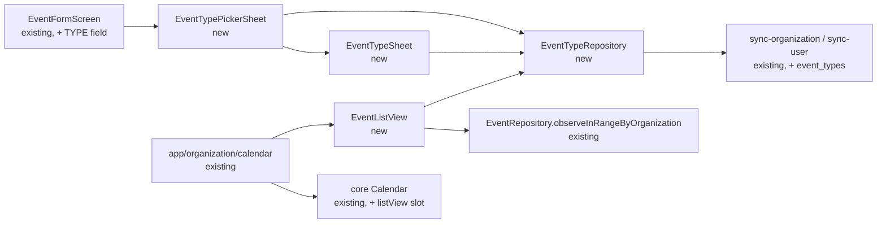
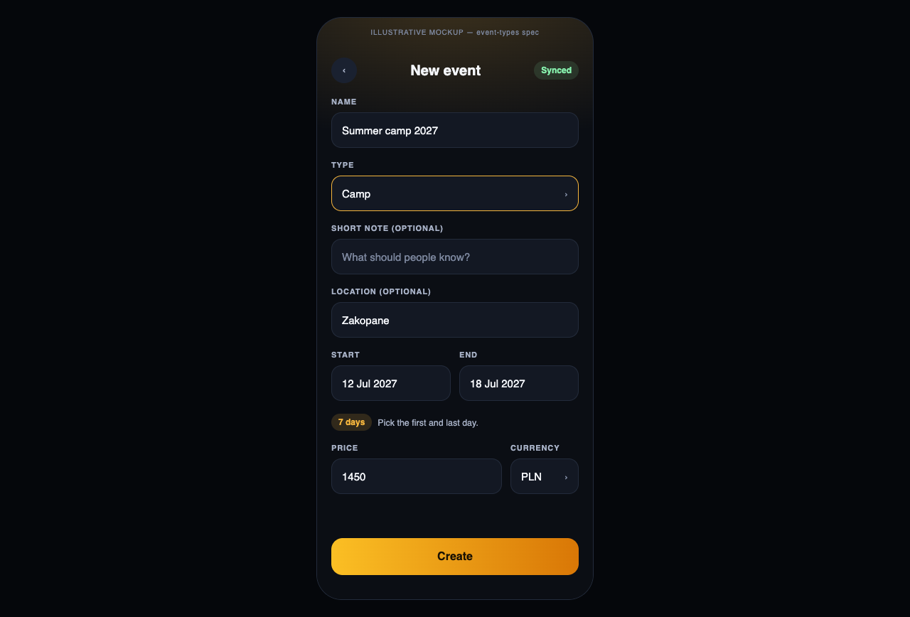
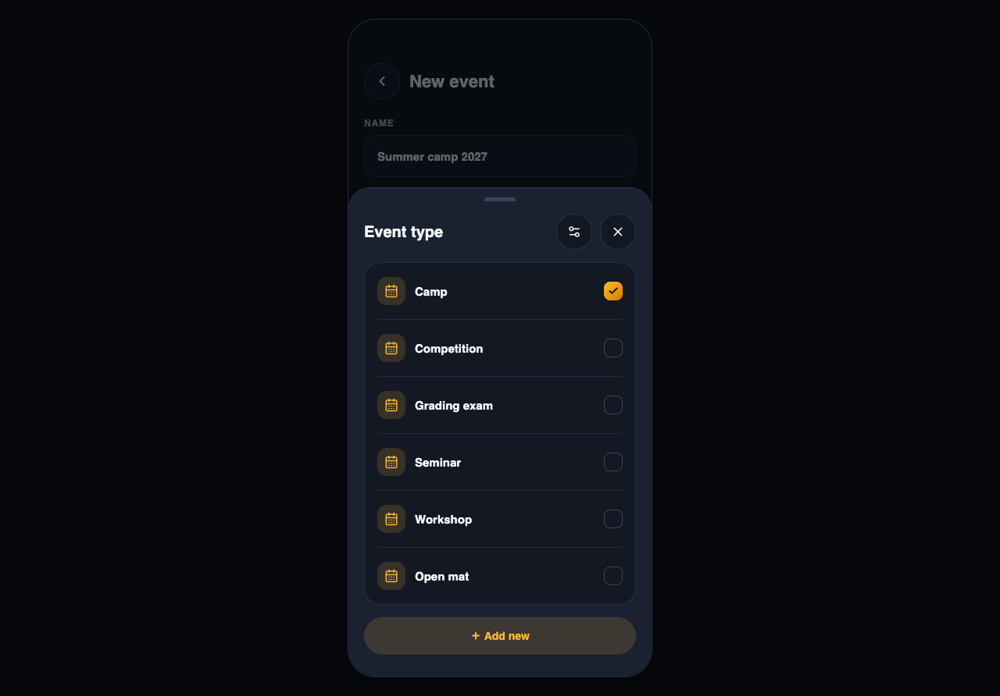
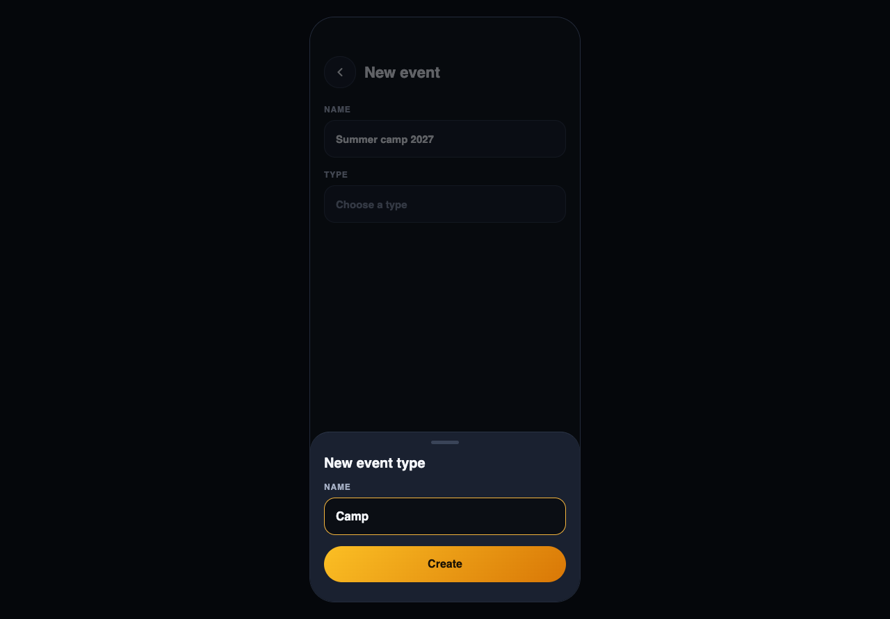
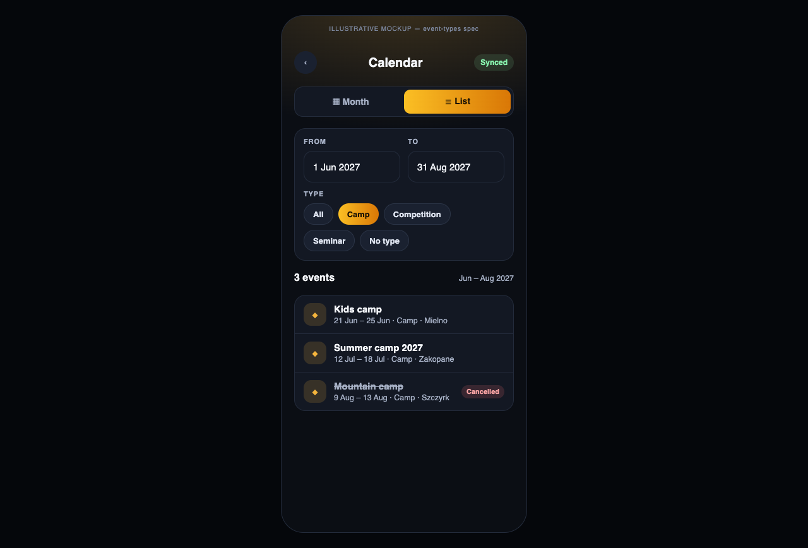

# Event Types & Filtered Event List

## 📝 TLDR
Proposed: every event gets an instructor-defined **type** (Seminar, Camp, Competition, …). Today an event has only a name, dates, place, price and audience, so an organization calendar cannot answer "which camps are planned this spring?". The event form gains a TYPE field that opens a picker sheet with the organization's types and **Add new** — the same pattern as the notebook's Tags sheet — and the organization calendar gains an alternative **List** view that filters events by a date range and a type.

## 📝 Problem Statement
- The owner plans many one-off events across schools (seminars, camps, gradings, competitions). The only way to find "all camps" is to page the month grid and read names.
- Event names carry the type informally ("Obóz letni", "Seminarium – …"), which is inconsistent and not filterable.
- The month grid (board 6) shows one day at a time; there is no way to see a range of events as a list.

## 📝 Proposed Solution
Two phases in one spec, because the list view's type filter is meaningless without types (see Resolved assumptions A1):

1. **Event types** — a new organization-scoped `event_types` table (name only), an optional `type_id` on `events`, a `TYPE` `SelectField` in the event form (10A / 10B) opening an `EventTypePickerSheet` (single choice, **Add new** → `EventTypeSheet` create, which selects the type it creates). Event details and calendar rows show the type.
2. **Filtered list view (organization calendar only)** — a `ViewSwitch` (Month / List) on `/organization/calendar`. List shows events whose dates overlap a FROM–TO range, optionally narrowed to one type, sorted by start date, each row opening the event.

**Alternatives considered**
- *Reuse `tags` / `taggables` for event types.* Lost: tags are personal (`tags.user_id`, synced by `sync-tags.ts` per user), multi-valued and rose-colored. Event types must be shared with every instructor of the organization and visible to students, and an event has exactly one.
- *Hard-coded enum of types.* Lost: the user explicitly wants types defined by the user.
- *Filter inside the month grid instead of a list.* Lost: the brief asks for a list result; a grid cannot show a multi-month range.

## 📝 Architecture
- **events module** owns everything new: `EventTypeRepository`, `eventTypeService`, `useEventTypes`, `EventTypePickerSheet`, `EventTypeSheet`, `EventTypesListScreen`, the `useEventList` hook and `EventListView`. No new module.
- **core `Calendar`** gets one optional prop, `listView?: ReactNode`; when present, it renders a `ViewSwitch` (Month / List) above the body and swaps in the slot. `core` keeps not importing from modules — the organization route composes `<Calendar listView={<EventListView … />} />`. School and student calendars pass nothing and are unchanged.
- **Reused primitives**: `SelectField`, `FormSheet` + `ListCard` / `ListRow` / `ListCheck` + `ActionPill` "Add new" (as in `TagPickerSheet`), `FormSheet` + `TextField` + `PrimaryButton` + `TrashButton` (as in `TagSheet`), `ViewSwitch`, `DateTimeField`, `ChipFilter`, `ListSection` / `ListRow` / `StatusBadge`, `ListEmpty`, `EventRepository.observeInRangeByOrganization` (already exists).
- **Sync**: `event_types` added to `sync-organization.ts` (push + pull by `organization_id`); `sync-user.ts` pulls the types referenced by the student's pulled events so students see the type name.

Takeaway: the change stays inside the events module plus one optional slot on the shared calendar; nothing else depends on it.

## 📝 Data Model

**New table `event_types`** (WatermelonDB schema in `src/modules/events/database/schema.ts`, model `src/database/models/EventType.ts`, Supabase migration):

| column | type | notes |
|---|---|---|
| `id` | uuid | `uuidv4()` |
| `organization_id` | string, indexed | owner scope |
| `name` | string | 1–40 chars, trimmed; unique per organization among non-deleted rows (case-insensitive, checked in the service) |
| `created_by` | string | user id |
| `created_at` / `updated_at` / `deleted_at` | number | soft delete |

**`events.type_id`** — new optional, indexed string column. Optional at the database level so every existing event stays valid; required by the form for new events and for any save (see A3).

- WatermelonDB: schema version 21 → 22, migration `createTable(event_types)` + `addColumns(events, [type_id])`.
- Supabase: `create table public.event_types` (FK `organization_id → organizations`), `alter table public.events add column type_id uuid references public.event_types(id)` (nullable, no cascade), RLS mirroring events: org owner manages; members of the organization's schools can `select`.
- No sensitive data: type names are organization vocabulary.

## 📝 API Contracts
No HTTP surface; internal module contracts only.

- `CreateEventDto` / `UpdateEventDto` / `EventResponseDto` gain `typeId?: string`.
- `createEventSchema` gains `typeId: z.string().uuid({ message: "eventValidationTypeRequired" })`; `updateEventSchema` gains the same field as required when the form sends it (the form always does).
- `eventTypeSchema`: `{ name: string 1–40 }` → errors `eventTypeValidationNameRequired`, `eventTypeValidationNameTooLong`, `eventTypeValidationNameTaken`.
- `EventTypeRepository`: `create`, `update`, `softDelete`, `findById`, `observeByOrganizationId(orgId)` (sorted by name, `deleted_at` null), `observeByIds(ids)`, `countActiveEvents(typeId)`.
- `eventTypeService`: `createEventType`, `renameEventType`, `deleteEventType` (throws `eventTypeInUse` when `countActiveEvents > 0`) — each calls `sync().catch(console.error)`.
- `filterEventList(events, { from, to, typeId })` — pure function in `components/eventList.ts`: keeps events with `start ≤ to && end ≥ from` and matching `typeId` (`null` = all), sorted by start date then name.

## 📝 UI/UX
Prototype: `.ai/specs/assets/event-types/` (static mockups, illustrative only).

| Event form with TYPE | Event type sheet (T5 pattern) | New event type (7B pattern) | Organization calendar — List |
|---|---|---|---|
|  |  |  |  |

**Event form (10A / 10B)** — `TYPE` `SelectField` directly under NAME: placeholder "Choose a type", value = type name, chevron. Tap → **Event type sheet**, a copy of the notebook's Tags sheet (board T5, `TagPickerSheet`) in the events amber:
- `FormSheet` titled "Event type", round close ✕; the T5 "N selected" `badge` is omitted (one value).
- One `ListCard` with a `ListRow` (`size="md"`) per type: `ListIcon` `CalendarDays` `accent="events"` `size={36}`, the name, and a `ListCheckbox` `accent="events"` on the right — the same rows as T5, no extra controls in the row.
- Single choice: tapping a row checks it and unchecks the previous one (T5 toggles freely). Like T5 the sheet stays open and closes via ✕ or swipe.
- Footer: full-width `ActionPill` **＋ Add new** in the amber fill (as T5).
- Add new → **New event type** sheet, a copy of 7B "New tag" (`TagSheet`): title, NAME `TextField` (amber focus border), full-width amber **Create** `PrimaryButton`. Create saves the type, checks it in the picker and goes back to it.
- No types yet: `ListEmpty` "No event types yet" in place of the card, Add new below.

**Rename / delete** — not in the picker, matching T5 (tags are edited on the Tags list, 7A / 7C). An **Event types** screen `/organization/events/types` copies `TagsListScreen`: rows → the 7C edit sheet (NAME, Save, `TrashButton`). It opens from a `headerAction` icon button (`Settings2`) in the Event type sheet — the one addition to T5, in the slot the "N selected" chip uses there.

**Event details / calendar rows** — the type name is the first part of the row meta (`Camp · Zakopane`) replacing today's generic "Event" kind label; events without a type keep "Event".

**Organization calendar — List view** — `ViewSwitch` (Month / List) under the header, organization amber.
- Filters card: FROM / TO `DateTimeField`s (default: first and last day of the month currently shown in Month view; TO ≥ FROM enforced by `min`) and a `ChipFilter` of types (All, then each type; plus "No type" when any listed event has none).
- Result: a `ListSection` titled "N events", one `ListRow` per event (title, `date range · type · place`, `StatusBadge` "Cancelled" when cancelled), tap → `/organization/events/{id}`. Empty → `ListEmpty` "No events match these filters".
- Filter state is screen-local and resets when the screen unmounts. Switching back to Month keeps the month.
- Trainings are not listed (they have no type) — List view is events-only.

## 📝 Edge Cases & Failure Scenarios
| Scenario | Behavior |
|---|---|
| Existing event without a type | Shows "Event" as today; list filter offers "No type"; opening edit requires picking a type before Save (A3). |
| Owner deletes a type used by an event | Blocked with notice "This type is used by N events" (A4); type stays. |
| Deleting an unused type | Soft delete after `confirmDelete`; disappears from picker and filter. |
| Duplicate name ("camp" vs "Camp") | Rejected by the service with `eventTypeValidationNameTaken`. |
| Type created offline on two devices with the same name | Both rows sync (uniqueness is client-side only); user sees two entries and can delete one. Acceptable for a name-only list. |
| Type deleted on another device while selected in an open form | Picker no longer lists it; Save proceeds with the stored `type_id`, which still resolves for display because soft-deleted types are still loadable by id. |
| Student device pulls an event whose type was not pulled | Row falls back to "Event"; no crash (type lookup is optional). |
| FROM after TO | Impossible: TO's `min` is FROM, and moving FROM past TO moves TO to FROM. |
| Range spanning many months | Single `observeInRangeByOrganization` query; organization event counts are small (tens–hundreds), no pagination. |

## 📝 Risks & Impact Review
- **Schema change** (new table + nullable column) — additive, backward-compatible: older app builds ignore `type_id`; the sync function must tolerate clients that do not send `event_types` (it already skips absent tables). Rollback = stop writing the column; the data can stay.
- **Required-on-save for legacy events** (A3) is a UX default that forces a one-time choice on the next edit of each old event. Reversible by relaxing the schema rule.
- **Org scoping** (A2) is the main product call: types are shared by the organization, not personal like tags. Changing it later means a data migration, so it should be confirmed before implementation starts — cheap now.
- The `Calendar` `listView` slot is the only change to a shared component; school/student calendars pass nothing and render exactly as today.

## Resolved assumptions (autonomous defaults)
| # | Question | Applied default | Why |
|---|---|---|---|
| A1 | Split event types and the filtered list into two specs? | One spec, two independently shippable phases. | The list's type filter depends on types; phase 2 can ship date-only if phase 1 slips. |
| A2 | Are types personal (like tags) or shared by the organization? | Organization-scoped, managed by the owner, readable by members. | Events are organization data seen by students and other instructors; personal types would differ per viewer. |
| A3 | Is a type required? | Required by the form on create and on any edit; column nullable so existing events stay valid. | The brief says "every event should have a type"; nullable column avoids a backfill. |
| A4 | Deleting a type that events use? | Blocked with a count notice. | Most reversible: no event loses its type silently. |
| A5 | Single or multiple types per event? | Single (a select). | The brief describes a select. |
| A6 | Do types have a color? | No — name only, events amber everywhere. | Smallest surface; color can be added later as an optional column. |
| A7 | Default list range and contents? | Range = the month shown in Month view; events only (trainings excluded); cancelled events listed with a badge. | Ties the list to the calendar's context; trainings have no type. |
| A8 | Is the list view available on school / student calendars? | No — organization calendar only. | The brief limits it to the organization calendar. |
| A9 | Where are types renamed / deleted? | On an Event types screen opened from the picker's header icon, not in the picker rows. | Keeps the picker identical to T5, which has no edit controls. |

## 📋 Phasing
- **Phase 1 — Event types.** Table, sync, picker + create/edit sheet, required TYPE field, type shown in details and calendar rows. Shippable alone.
- **Phase 2 — Filtered list view.** `Calendar` `listView` slot, `EventListView` with date range + type filter on the organization calendar. Depends on Phase 1 for the type chips; can ship date-only otherwise.

## 📋 Implementation Plan

**Phase 1 — Event types**
1. Supabase migration `event_types` + `events.type_id` + RLS (owner manages, org members select). Test: migration applies on a fresh `supabase db reset`.
2. WatermelonDB: `EventType` model, schema entry, `events.type_id` column, migration v22, model registered. Test: typecheck + app boots on an existing v21 database.
3. Sync: push/pull `event_types` in `sync-organization.ts`; pull referenced types in `sync-user.ts`. Test: Deno tests for both pulls (`sync-user.test.ts` pattern).
4. `EventTypeRepository` + `eventTypeService` + `eventTypeSchema` + `useEventTypes`. Test: unit tests for name trim/uniqueness and delete-in-use rejection.
5. `EventTypeSheet` (7B / 7C copy: create / rename / delete), `EventTypePickerSheet` (T5 copy, single choice) and `EventTypesListScreen` at `/organization/events/types` (7A copy); translations (en + pl, duplicate-checked). Test: translations test passes; picker matches board T5 side by side.
6. Event form: TYPE `SelectField`, `typeId` in `EventFormState`, validation and DTOs; create/update pass `type_id`. Test: `eventFormState.test.ts` covers missing type error and legacy event edit.
7. Show the type in event details and calendar row meta (`Calendar` items carry `typeName`). Test: `calendarMonth`/`toRow` test for meta with and without a type.

**Phase 2 — Filtered list view**
8. `filterEventList` pure helper + tests (overlap at range edges, type, "No type", sort order).
9. `useEventList(organizationId, from, to)` over `observeInRangeByOrganization` + `useEventTypes`.
10. `EventListView` (filters card + result list + empty state).
11. `Calendar` `listView` prop with `ViewSwitch`; organization calendar route passes `EventListView`. Test: school and student calendars render without the switch; manual QA of the org calendar on device.
