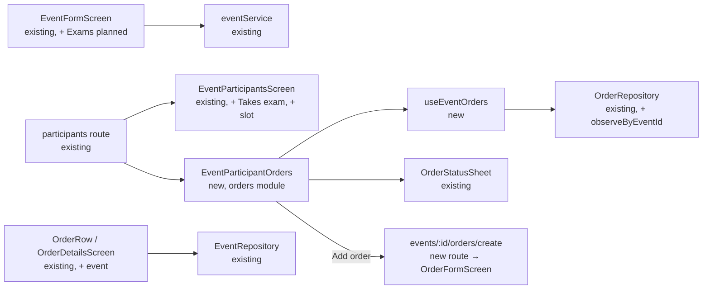

# Event Exams & Event-Linked Orders

## 📝 TLDR
Proposed: an event can be marked **"Exams planned"** in the event form (10A / 10B). On such an event the Participants screen (10D) shows a **"Takes exam"** switch under every participant; for a participant who takes the exam an **Add order** button opens the New order form (12E) with that student fixed, and the created order is **linked to the event**. The participant row then lists their event orders, and the owner changes an order's status right there. Order lists and order details show the event an order belongs to, with a link to the event details (owner → organization event details, student → their own event details). Today events and orders are unrelated, so at an exam event the instructor tracks by hand who ordered an exam fee, a belt or a certificate.

## 📝 Resolved assumptions (autonomous defaults)
The user asked for the run to continue without further questions; each gate question was resolved with the most reversible answer that still delivers the described flow. Override any of them before implementation.

| # | Question | Chosen answer | Rationale |
|---|---|---|---|
| Q1 | One spec or two? | **One spec, two independently shippable phases**: Phase 1 exam flags, Phase 2 event-linked orders. | The user described one flow (exam → order). The phases still ship separately, so dropping Phase 2 later costs nothing. |
| Q2 | Who gets **Add order**? | **Only participants with "Takes exam" on.** | This is what the user described, and it is the smallest surface. Widening it later means removing one condition. |
| Q3 | Turning exams off while linked orders exist | **Allowed. Orders stay linked and visible.** Switching off only hides **Add order** and the switches. | No data loss and no blocking dialog. Switching back on restores the same state. |
| Q4 | Save model on 10D | **"Takes exam" and order status apply immediately.** Participation statuses keep their draft + **Save**. | **Add order** leaves the screen, so a "Takes exam" waiting for Save would gate the button on unsaved state. Order status already applies immediately in 12C. ⚠ NEEDS HUMAN CONFIRMATION: one screen then has two save models. |
| Q5 | Student's event details show their exam and orders? | **No (deferred).** The student reaches the event from their order details only. | The user named only the order → event direction for students. The student event screen is left unchanged. |
| Q6 | Attach existing orders to an event? | **No.** Only orders created from the event are linked, and there is no unlink. | No new picker, no unlink rules. An unwanted link is fixed by deleting the order (staff can always delete). |
| Q7 | Exam result / rank promotion | **Out of scope.** | Grading results are a separate capability with its own data model. |

## 📝 Problem Statement
- Exam events (gradings) are where students buy exam fees, new belts and certificates. The owner already enters those orders in the Orders module, but nothing ties them to the event. The event cannot answer "who takes the exam, and has everyone ordered or paid for their belt?".
- From the order side, an order for a belt gives no hint that it was for the June grading. On a list of 40 orders the owner cannot tell event orders from regular ones.
- Today an event participant has only a participation status (absent / attending / paid). There is no notion of taking an exam.

## 📝 Proposed Solution
**Phase 1: exam flags.**
- `events.exams_planned` (bool, default `false`): a **`ToggleRow` "Exams planned"** in `EventFormScreen` (10A / 10B), placed after PRICE / CURRENCY and before "Who can see it?". It is part of the form state, saved with Create / Save, and counts towards the dirty check (`hasEventChanges`).
- `event_participants.takes_exam` (bool, default `false`): when the event has exams planned, each participant row on 10D shows a **`ToggleRow` "Takes exam"** as its row content (`ListRow` children, always expanded). A toggle writes immediately (Q4). The event details (10C) show an **"Exams planned"** chip next to the type. `ParticipantSummary` gets no new segment; exam takers are counted in a muted line under the summary ("4 take the exam").

**Phase 2: event-linked orders.**
- `orders.event_id` (optional, indexed): an order belongs to at most one event. The order's `school_id` stays the participant's own school, because an organization-wide event mixes members of several schools. Every existing order list keeps working unchanged.
- Event side (10D): under "Takes exam" each exam taker gets an **Add order** button (`SecondaryButton size="sm"`, orders accent) and the list of their linked orders. Each order is a compact `ListRow` (product or "N items", day, total) with a `StatusBadge`. Tapping the badge opens the existing `OrderStatusSheet` (12C), which applies immediately. Tapping the row opens the order details under `/organization/orders/[orderId]`. A participant whose exam was switched off but who has linked orders still sees the orders, without **Add order** (Q3).
- **Add order** pushes `/organization/events/[eventId]/orders/create?memberId=…`. That route renders the existing `OrderFormScreen` with `scope="school"` and the member's school (`useMemberSchoolId`). `OrderFormScreen` gains two optional props:
  ```ts
  interface OrderFormScreenProps {
    scope: Exclude<OrdersScope, "organization">;
    schoolId: string | undefined;
    memberId?: string;          // student scope: the ordering member (unchanged)
    /** Staff scope: the student is fixed (STUDENT shown as TextField locked). */
    fixedStudentId?: string;
    /** Links the created order to this event; shows "For the event {name}" under STUDENT. */
    event?: { id: string; name: string };
    onCreated: () => void;
  }
  ```
- Order side: `OrderRow` adds the event as a subtitle segment with a small lucide `CalendarDays` icon in the events accent ("Kowalski · 3 items · 12 Jun · 🗓 Summer grading"). `OrderDetailsScreen` adds an **Event** row (`ListRow`, events `ListIcon`, the event name, a date range subtitle, a chevron) to its summary card. It calls `onOpenEvent(eventId)`, which each route maps to its own event details:
  - `/organization/orders/[orderId]` → `/organization/events/[eventId]`
  - `/user/orders/[orderId]` → `/user/events/[eventId]`
  - `/school/[schoolId]/orders/[orderId]` → `/organization/events/[eventId]` when the user owns the organization; otherwise the row is shown without a chevron and does nothing.

**Alternatives considered**
- *A join table `event_orders` (event_id, order_id, member_id).* Lost: it would allow many-to-many links that the flow does not need, adds a third table to sync and to RLS, and still needs a uniqueness rule. One nullable column on `orders` expresses "an order belongs to at most one event" directly.
- *`event_participant_id` on orders instead of `event_id`.* Lost: the participant row is soft-deleted when a member is removed from a whitelist event, and the order would then lose its event. `event_id` + the existing `school_member_id` already identify the participant.
- *Exam takers as a fourth participation status ("exam").* Lost: taking an exam is independent of attending or paying. A paid participant also takes the exam.
- *Draft + Save for "Takes exam" (as statuses).* Lost (Q4): **Add order** would have to wait for Save, or the screen would autosave behind the user's back.

**Research (from domain knowledge; web search was unavailable in this run, so this is unverified):** martial-arts CRMs such as Kicksite, Spark Membership and Zen Planner model belt testing as an event with *eligible / registered testers* and a testing fee charged at registration, and record the outcome as a promotion. This spec covers the registration half (who tests, what they ordered) and skips their complexity: eligibility rules (attendance thresholds), automatic fee charging (no online payments by product decision) and promotion records (Q7).

## 📝 Architecture
- **events module** (Phase 1) owns the two flags: the schema columns, `Event.examsPlanned` and `EventParticipant.takesExam`, the form field, `eventService.setParticipantTakesExam`, `EventParticipantRepository` (`observeByEventId` and the per-member observer add `"takes_exam"` to `observeWithColumns(["status"])`, otherwise a toggle never re-renders) and the "Takes exam" switch on `EventParticipantsScreen`.
- **orders module** (Phase 2) owns the link: `orders.event_id`, `createOrderWithItems(…, eventId?)`, a new `OrderRepository.observeByEventId`, a hook `useEventOrders(eventId)` (a `Map<memberId, OrderListEntry[]>`), the presentational `EventParticipantOrders` (orders + Add order) and the event row in `OrderRow` / `OrderDetailsScreen`.
- **Dependency direction: `orders → events` only.** Orders read event names through `EventRepository.findByIds` / `observeById`, the same way they already read `students`, `school` and `inventory` repositories. `events` does **not** import `orders`: `EventParticipantsScreen` gets one optional slot prop, `renderParticipantContent?: (p: { schoolMemberId; takesExam; name }) => ReactNode`, and the route `app/organization/events/[eventId]/participants.tsx` fills it with `EventParticipantOrders`. This is the same composition the event-types spec used for `Calendar.listView`.
- **Reused primitives**: `ToggleRow`, `ListRow` children + `expanded`, `SecondaryButton`, `StatusBadge`, `OrderStatusSheet`, `ORDER_STATUS_STYLE`, `OrderFormScreen`, `TextField locked`, `ListIcon`. No new core component.
- **Sync**: no new tables. Both sync functions already push and pull `events`, `event_participants` and `orders`. The WatermelonDB `addColumns` migration (v22 → v23) is picked up by `columnMigratedTables`, so existing rows are re-pulled with the new columns. In `sync-user` (student pushes), a sanitizer modeled on `ownMembershipPush` drops `takes_exam` from `event_participants` and `event_id` from `orders`. A student cannot mark themselves as an exam taker or link an order to an event.


Takeaway: the orders module depends on events, never the reverse. The only change to events for Phase 2 is one optional render slot.

## 📝 Data Model
WatermelonDB schema version **22 → 23**, one `addColumns` step per table in `src/database/migrations.ts`; Supabase migration `supabase/migrations/20261022000000_event_exams_orders.sql` (check the remote migration history for a free version first).

| table | column | type | notes |
|---|---|---|---|
| `events` | `exams_planned` | bool, default `false` (Supabase `boolean not null default false`) | form field. WatermelonDB reads a missing value as `false`. |
| `event_participants` | `takes_exam` | bool, default `false` | only meaningful when the event has exams planned. The value is kept when exams are switched off (Q3). |
| `orders` | `event_id` | string, optional, indexed (Supabase `uuid null references events(id)`, index `orders_event_id_idx`) | set at creation only. It is never changed afterwards by any client path. |

- Models: `Event.examsPlanned` (`@field("exams_planned")`), `EventParticipant.takesExam`, `Order.eventId` + `events: belongs_to` association.
- DTOs: `CreateEventDto` / `UpdateEventDto` / `EventResponseDto` gain `examsPlanned`; `CreateEventFormValues` (Zod) gains `examsPlanned: z.boolean().default(false)`; `OrderListEntry` gains `eventId?` / `eventName?`; order details gain `event?: { id; name; startDate; endDate }`.
- RLS: no policy changes. Staff policies on `orders` already allow organization owners. The student path is guarded by the `sync-user` sanitizer above. An `event_id` that does not exist fails the FK, and that is how sync errors are already handled.
- Sensitive data: none. Two booleans and a foreign key.
- Rollback: the columns are additive and nullable/defaulted. Rolling back the app ignores them. Rolling back the schema needs a new forward migration (WatermelonDB cannot drop columns), so the columns stay in place unused.

## 📝 API Contracts
No HTTP endpoints. Internal service contracts:
- `eventService.createEvent` / `updateEvent`: accept `examsPlanned`.
- `eventService.setParticipantTakesExam(participantId: string, takesExam: boolean, changedBy: string): Promise<void>` writes `takes_exam` in `database.write()` and then calls `sync().catch(console.error)`.
- `orderService.createOrderWithItems(schoolId, memberId, items, eventId?: string)`: `createOrderSchema` gains `eventId: z.string().uuid().optional()`. The service checks that the member is a non-deleted participant of that event with `takes_exam = true`, and otherwise throws `errorOrderEventNotAllowed`.
- `OrderRepository.observeByEventId(eventId)`: orders with `event_id = eventId`, `deleted_at = null`, newest first.

## 📝 UI/UX
- **10A / 10B event form**: `ToggleRow` "Exams planned" with the hint "Participants can be marked as taking the exam". Events accent.
- **10C event details**: `ListChip` "Exams planned" next to the type when on. Nothing else changes.
- **10D participants** (exams planned): each row keeps its avatar, name and `ParticipantStatusButton`, and below it (row children) shows:
  1. `ToggleRow` "Takes exam" (events accent, immediate);
  2. Phase 2, when it is on: the linked orders (compact `ListRow`s with a `StatusBadge`) and **Add order** (`SecondaryButton sm`, orders accent).
  A muted line under `ParticipantSummary` reads "N take the exam". Events without exams planned look exactly as today, except for a participant who still has linked orders (Q3): they keep the read-only list.
- **12E from an event**: the STUDENT field is a `TextField locked` with the member name and the hint "For the event {event name}". Products and Create work as today, and after Create the app returns to 10D.
- **12A order lists** (organization, school, student): event orders carry the event segment in the subtitle. The student row (product title) gets it as a third subtitle part.
- **12D order details**: an **Event** row in the summary card, under the member, with a chevron when it can navigate.
- Accessibility: the switch rows carry the participant name in their label ("Takes exam, Anna Kowalska"); the status badge button reads "Change status, Paid".
- New translation keys (search `en.json` / `pl.json` / `hu.json` for duplicates first): `eventsExamsPlanned`, `eventsExamsPlannedHint`, `eventsTakesExam`, `eventsExamTakersCount`, `ordersAddOrder` (reuse an existing "Add order" key if one exists), `ordersForEvent`, `ordersEvent`, `errorOrderEventNotAllowed`.

## 📝 Edge Cases & Failure Scenarios
- **"Takes exam" toggled while participation statuses are unsaved.** Once `takes_exam` is in `observeWithColumns`, the immediate write re-emits `observeByEventId`, and `useEventParticipants.updateList` would overwrite draft statuses with DB values. The hook must keep local drafts on re-emission (merge by participant id; take the DB value only for rows without a draft). This step is required in Phase 1 and covered by a test.
- **Exams switched off with linked orders** (Q3): orders stay linked. 10D shows them read-only for those participants. Order lists still show the event.
- **Participant removed from the event** (whitelist edit soft-deletes the participant): the orders keep `event_id`. Staff still see the event on the order. The student's sync no longer pulls that event, so the Event row is hidden on their side (graceful: missing event → no row).
- **Event cancelled or deleted**: orders keep the link. The Event row shows the name with the cancelled chip (as 10C does). If the event is soft-deleted, the row is hidden.
- **Member's school deleted / member left**: unchanged order behavior; the event link adds nothing new.
- **Offline, event and order created before one sync**: `sync-organization.ts` `tablesToSync` currently pushes `orders` (index 48) **before** `events` (index 55). An order whose event is also new would fail the `event_id` FK and be dropped from that push. Step 7 moves `events` (and `event_types`, which events reference) ahead of `orders` in `tablesToSync`, with a test.
- **Student device pushes a tampered `event_id` / `takes_exam`**: the `sync-user` sanitizer drops both fields, so the server value stays.
- **Two owners change one order's status at once**: last write wins, as today in 12C.
- **Create fails validation** (participant no longer takes the exam): the form shows `errorOrderEventNotAllowed` above Create, as other create errors are shown.

## 📝 Risks & Impact Review
- **Schema (hard to reverse)**: three additive columns. WatermelonDB cannot drop them, so they would stay as dead columns if the feature were dropped. Low impact.
- **Two save models on 10D** (Q4, ⚠): immediate switches next to draft statuses could confuse the owner. Mitigation: switches carry no "unsaved" indicator, and Save stays tied to statuses only. Revisit after QA.
- **Deploy order**: sync pushes pass every client column through (`convertToSupabaseRecord`), so a v23 client pushing `exams_planned` / `takes_exam` / `event_id` to a server without the columns fails the whole upsert. In each phase, the Supabase migration and the redeployed `sync` edge function ship **before** the app build.
- **Phase 1 save model**: Phase 1 already uses the immediate "Takes exam" write (Q4), although its justification (Add order) arrives in Phase 2. This is deliberate, so the save model does not change between phases. Phase 1 is still usable alone: the owner sees who takes the exam.
- **Module dependency**: introduces `orders → events`. The repo already has bidirectional imports elsewhere (`students ↔ events`, `students ↔ orders`); this spec adds no new cycle, because `events` stays unaware of `orders`.
- **Product direction vs. rule violations**: Q4 (immediate writes) and Q5 (no student event view) are product calls, not repository-rule violations. No CLAUDE.md rule is broken. Direct Supabase calls are not used, and every write goes through WatermelonDB.

## 📝 Decisions in play
No `product-brief.md` exists. CLAUDE.md "Key Features Not Included: no online payment processing" is respected: exam fees are ordinary manual orders.

## 📋 Phasing
- **Phase 1: Exam flags.** "Exams planned" on the event, "Takes exam" per participant, details chip, exam-taker count. Ships alone: the owner sees who takes the exam.
- **Phase 2: Event-linked orders.** `orders.event_id`, Add order from 10D, orders under the participant with in-place status change, the event on order lists and details. Depends on Phase 1.

## 📋 Implementation Plan

### Phase 1: Exam flags
1. **Schema + models.** Add `exams_planned` to `events` and `takes_exam` to `event_participants` (WatermelonDB schema v23 + `addColumns` migration, models, Supabase migration with defaults). Test: migration test / typecheck; an existing event reads `examsPlanned === false`.
2. **Sync guard + deploy.** In `supabase/functions/sync/utils.ts` add `studentParticipantPush` (drops `takes_exam`) and use it in `sync-user.ts` `filterUserData`, replacing the `event_participants` pass-through case. Apply the Supabase migration and redeploy `sync` before any app build with v23. Test: Deno unit test next to `sync-user.test.ts`.
3. **Event form.** `examsPlanned` in `EventFormState`, `CreateEventFormValues`, the DTOs, `eventService.createEvent` / `updateEvent`, and the `ToggleRow` in `EventFormScreen`; `hasEventChanges` includes it. Translations in en / pl / hu. Test: `eventFormState.test.ts` covers the dirty check and default.
4. **Details chip.** "Exams planned" `ListChip` on `EventDetailsScreen`. Test: render test or snapshot of the chip condition (pure helper).
5. **Draft-preserving participants hook.** Change `useEventParticipants.updateList` to keep local draft statuses on re-emission; expose `takesExam` on `ParticipantWithMember`. Test: `useEventParticipants` test — a re-emit with a changed `takes_exam` keeps a draft status.
6. **Takes exam switch.** Add `"takes_exam"` to both `observeWithColumns` calls in `EventParticipantRepository`; `eventService.setParticipantTakesExam` + hook method; `ToggleRow` as row children on `EventParticipantsScreen` when `event.examsPlanned`; "N take the exam" line. Test: service test (write + sync call), translations test.

### Phase 2: Event-linked orders
7. **Schema + model.** `orders.event_id` (WatermelonDB v24 if Phase 1 has already shipped, otherwise folded into v23; Supabase FK + index), `Order.eventId`, `belongs_to events`. The migration step lists `orders` / `event_id` in its columns, so `columnMigratedTables` re-pulls existing orders. In `sync-organization.ts`, push `event_types` and `events` before `orders`, and deploy server-side first. Test: typecheck; migration applies; a Deno test asserts that `events` precedes `orders` in the push order.
8. **Sync guard.** Add a sanitizer that drops `orders.event_id` from student pushes, replacing the `orders` pass-through case in `filterUserData`. Test: Deno unit test.
9. **Create with event.** `createOrderSchema.eventId`, `createOrderWithItems(…, eventId?)` with the participant/exam check, `useCreateOrder` passes it through. Test: service test — allowed for an exam taker, rejected otherwise, `event_id` stored.
10. **Event orders data.** `OrderRepository.observeByEventId`, `useEventOrders(eventId)` (entries grouped by member, reusing `toEntries`). Test: pure grouping helper test.
11. **`EventParticipantOrders` + slot.** Presentational orders list + Add order in the orders module; `renderParticipantContent` slot on `EventParticipantsScreen`; the participants route composes them and wires `OrderStatusSheet` → `updateOrderStatus` (immediate). Test: grouping/visibility helper (`showsAddOrder(takesExam, examsPlanned)`, read-only orders when exams are off).
12. **Create route.** `app/organization/events/[eventId]/orders/create.tsx` (owner guard) → `OrderFormScreen scope="school"` with the member's school (new `useMemberSchoolId` in orders), `fixedStudentId` and `event`; returns to 10D. Test: `OrderFormScreen` fixed-student branch via a pure helper (`studentFieldMode(scope, memberId)`).
13. **Event on order lists.** `OrderListEntry.eventId` / `eventName` from `EventRepository.findByIds` in `useOrdersList`; `OrderRow` subtitle segment with the icon; an event missing locally (a student no longer a participant) renders no segment. Test: entry-mapping test, including the missing-event case.
14. **Event on order details.** Event row in `OrderDetailsScreen` with `onOpenEvent`; the three order-details routes map it (organization → org event, user → user event, school → org event only for the owner). Test: helper test for the target route per scope + ownership; translations test.
15. **Gate.** `npm run typecheck`, `npm run check:theme`, Jest and the Deno sync tests; manual QA of 10A → 10D → 12E → 12A / 12D for the owner and for a student.
