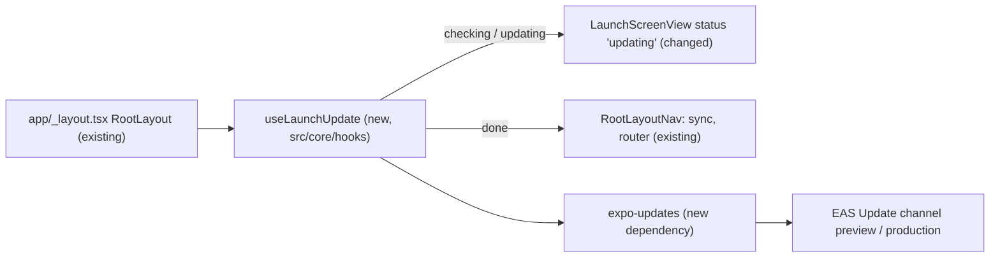

# Forced over-the-air update on launch (EAS Update)

## 📝 TLDR

Today a new preview version only reaches testers when the owner sends a new
install link for every build. Proposed: the app uses EAS Update. On every cold
start it checks the build's channel for a newer JS bundle, downloads it while
the launch screen shows "Updating the app…", and restarts on it before the
first screen opens. JS-only releases then need just
`eas update --channel preview` and no link. Native changes still need a new
build. This spec covers that case only through the fingerprint runtime
version, and leaves a "minimum build" gate for later.

## 📝 Problem Statement

- `expo-updates` is not installed (`package.json`, `app.json`), so a preview
  build (`eas.json` → `preview`, `distribution: internal`) can only change
  through a reinstall from a new EAS link.
- Most releases change only JS/TS (screens, logic, translations), and every one
  of them now costs a link round-trip, plus testers who stay on old builds.

## 📝 Proposed Solution

- **EAS Update** with one channel per build profile (`preview`, `production`).
  The build pins its channel, and `eas update --channel <name>` publishes.
- **Runtime version `{ "policy": "fingerprint" }`**: a build only accepts
  bundles made from the same native fingerprint. A JS bundle that needs native
  code an older build lacks can never reach that build.
- **Forced on cold start, bounded, never blocking offline.** Expo's built-in
  `checkAutomatically: ON_LOAD` downloads in the background and applies on the
  *next* launch, so it does not force anything. The app turns it off
  (`checkAutomatically: "NEVER"`, `fallbackToCacheTimeout: 0`) and runs the
  check itself while the launch screen shows:
  1. Skip when `Updates.isEnabled` is false (dev client, Expo Go, web) or the
     device is offline.
  2. `checkForUpdateAsync()`, limited to **3 s**.
  3. If an update is available: show "Updating the app…", then
     `fetchUpdateAsync()`, limited to **20 s**, then `reloadAsync()`.
  4. Any timeout or error → continue on the current bundle and log the error.
     The next cold start tries again. A finished download is still applied by
     expo-updates on the next launch.

Alternatives that lost:
- *Default `ON_LOAD` (apply on next launch)*: no forcing, and a tester can stay
  one version behind indefinitely.
- *Check on every return to foreground*: a reload in the middle of a session
  throws away unsaved form drafts. Cold start only.
- *Self-hosted updates server / CodePush*: more infrastructure. EAS is already
  the build host (`extra.eas.projectId`).

## 📝 Architecture

The update gate sits in front of `RootLayoutNav`, so sync and navigation start
only once the app knows it will not reload.

- `src/core/hooks/useLaunchUpdate.ts` (new): returns
  `"checking" | "updating" | "done"`. It is the only importer of
  `expo-updates`. The online flag comes from NetInfo, the same source the sync
  store uses. `core` imports no module, which follows the core rule.
- `src/core/hooks/launchUpdate.ts` (new, pure): `runLaunchUpdate(deps)` holds
  the timeouts and the decision steps, with `expo-updates` and online state
  injected so tests can run it.
- `app/_layout.tsx`: the native splash hides as today. While the hook is not
  `done`, `RootLayout` renders `LaunchScreenView` (`syncing` while checking,
  `updating` while downloading) instead of `RootLayoutNav`. The splash → launch
  screen handoff stays seamless because both draw the logo in the same place
  (L2).
- `LaunchStatus` gains `"updating"`. `LaunchScreenView` shows the same
  indeterminate `LaunchProgress` with `t("launchUpdating")`.
- Config: `app.json` → `runtimeVersion: { policy: "fingerprint" }`,
  `updates: { url: "https://u.expo.dev/<projectId>", checkAutomatically:
  "NEVER", fallbackToCacheTimeout: 0 }`. `eas.json` → `"channel": "preview"` /
  `"channel": "production"` on those profiles.
- `npm run update:preview` script →
  `eas update --channel preview --environment preview`, so the bundle is built
  with the preview environment variables (Supabase URL / anon key), the same
  ones the build uses.

## 📝 Data Model

None: no table, no schema, no sync change.

## 📝 UI/UX

- Launch screen (L2), new state: the progress bar plus "Updating the app…" in
  the place of "Syncing your schools…". There is no button and no way to
  skip, and the state lasts at most about 23 s.
- Offline (L3): unchanged, with no check and no delay.
- New translation key `launchUpdating`: en "Updating the app…", pl
  "Aktualizuję aplikację…", hu "Az alkalmazás frissítése…". `en.json` was
  searched and has no existing equivalent.

## 📝 Edge Cases & Failure Scenarios

| Case | Behavior |
| --- | --- |
| Offline or captive network | Online flag false → no check. Captive network → the 3 s check timeout, then the app opens. |
| Slow download | 20 s cap → the app opens on the old bundle and expo-updates applies the cached download on the next launch. |
| Broken update published | expo-updates rolls back to the embedded bundle after a launch crash. Fix: `eas update:rollback` or publish a fix. |
| Native change published as OTA | Fingerprint mismatch → old builds never receive it. Those testers need the new build link (out of scope, see Phasing). |
| Unsynced local changes | The reload happens before sync and the router start. WatermelonDB keeps local changes on disk and the next sync pushes them. |
| Dev client / Expo Go / web | `Updates.isEnabled` false → skipped. |

## 📝 Risks & Impact Review

- New native dependency (`expo-updates`). Every existing preview install needs
  **one** last reinstall from a link. After that, JS releases arrive over the
  air.
- The fingerprint changes whenever native config changes, so a build made
  after such a change does not see older updates. This is intended.
- Rollback: remove the hook and the config, then build again. The OTA content
  itself is rolled back with `eas update:rollback`.
- EAS Update free tier limits (monthly active users / bandwidth) are plenty
  for preview. Check them before a production launch.

## 📝 Resolved assumptions (autonomous defaults)

| # | Question | Applied default | Why |
| --- | --- | --- | --- |
| Q1 | Bundle a "minimum build" gate (block screen + link) for native changes? | No. Separate follow-up spec | It can be deployed on its own and needs a Supabase config contract. OTA alone removes most links. |
| Q2 | Force (block launch) or apply on next launch? | Force on cold start, with 3 s check / 20 s download caps | This is what was asked for. The caps keep offline-first usable. |
| Q3 | Also check when the app returns to foreground? | No | A reload mid-session would throw away unsaved forms. |
| Q4 | Runtime version policy | `fingerprint` | The safest choice: a bundle can never run against the wrong native code. |
| Q5 | Channels | `preview` and `production`. `development` has none | One channel per distributed profile. The dev client loads from Metro. |
| Q6 | Show the update id / version in Settings? | Deferred | Not needed to deliver updates. Small follow-up. |

## 📋 Phasing

- **Phase 1 (this spec):** forced OTA update on cold start for preview and
  production builds.
- **Later (separate spec):** a minimum-build gate for native releases
  (Supabase-held minimum build per platform → blocking "Update the app"
  screen with the install link). Then Play internal testing / TestFlight
  replace links entirely.

## 📋 Implementation Plan

1. **Config.** `npx expo install expo-updates`, add `runtimeVersion` and
   `updates` to `app.json`, add `channel` to the `preview` / `production`
   profiles in `eas.json`, add the `update:preview` script. Check: typecheck
   passes and `npx expo config --type public` shows `updates.url`.
2. **Pure flow.** `launchUpdate.ts` + `__tests__/launchUpdate.test.ts`: skip
   when disabled or offline, no update → done, update → updating → reload,
   check timeout → done, fetch timeout → done, errors → done.
3. **UI state.** `LaunchStatus` `"updating"`, `LaunchScreenView` text, and the
   `launchUpdating` key in en / pl / hu. Update the launchStatus test.
4. **Wire-up.** `useLaunchUpdate` hook, and `app/_layout.tsx` renders
   `LaunchScreenView` until `done`. Check: `npm run typecheck`,
   `npm run check:theme`.
5. **Device verification.** Build preview (`eas build -p android --profile
   preview`), install, change a visible string, run `npm run update:preview`,
   cold start → "Updating the app…" → the new string. Airplane mode → the app
   opens at once.
6. **Docs.** A short "Releasing a preview" note in the README: when
   `update:preview` is enough and when a new build is needed (native
   dependency, `app.json` plugins / permissions, Expo SDK upgrade).
