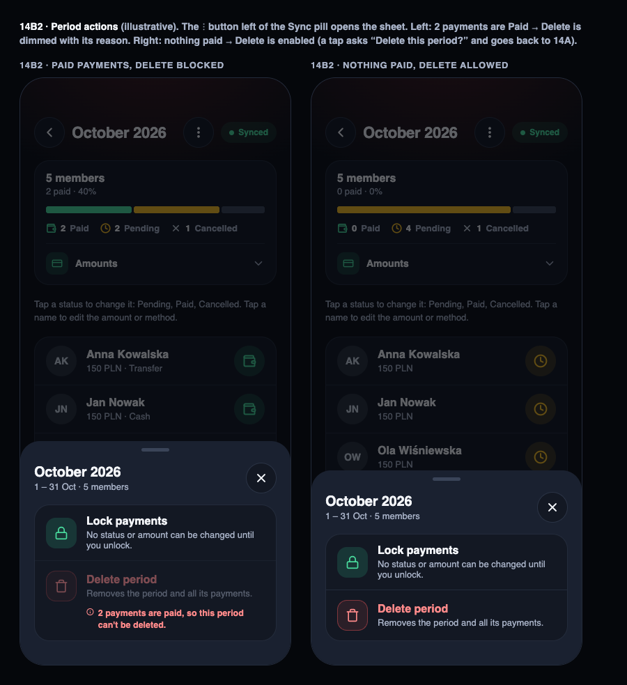
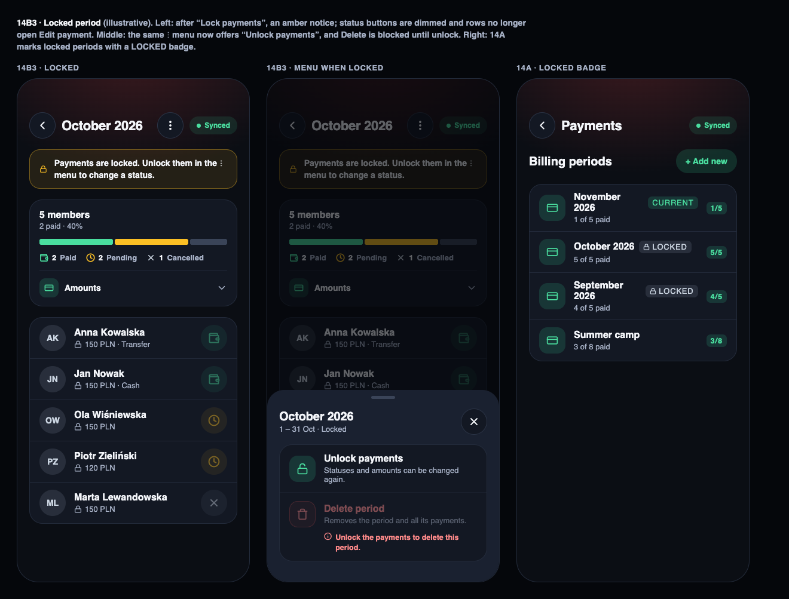
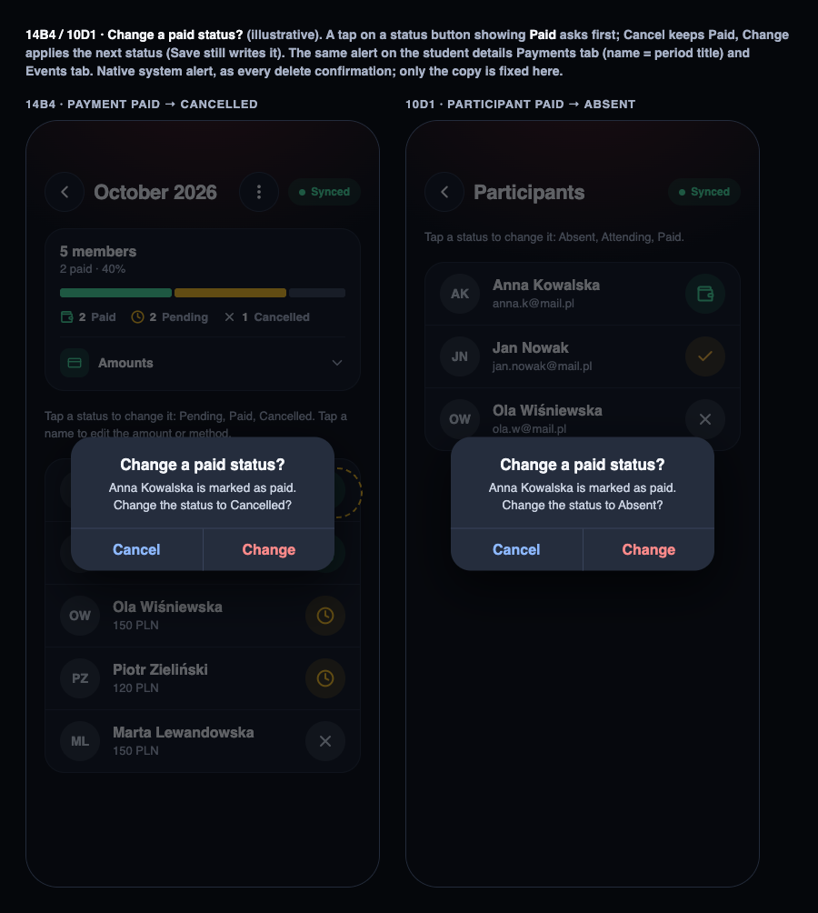

# Payments — lock a period, confirm leaving Paid, stay after Save

> Extends [2026-09-26-payments-module.md](2026-09-26-payments-module.md) (as-built payments) and touches the participants list of [2026-09-27-events-module.md](2026-09-27-events-module.md).

## 📝 TLDR
Proposed: an instructor managing a billing period (14B) gets a `⋮` menu in the header with **Lock payments / Unlock payments** and **Delete period**. A locked period freezes every status and amount, everywhere it can be edited. Delete is offered only while no payment in the period is Paid. Separately, any tap that would move a payment or an event participant **out of Paid** asks "Change a paid status?" first, and Save on the period screen keeps the instructor on that screen instead of going back to the list. Today a single mistaken tap silently un-pays a member, a closed month stays editable forever, a period created by mistake cannot be removed, and every Save throws the instructor out of the period.

## 📝 Problem Statement
- **A Paid status is one tap away from being lost.** The status button cycles Pending → Paid → Cancelled (`nextPaymentStatus`, `paymentPeriod.ts`) and Absent → Attending → Paid → Absent for event participants (`nextParticipantStatus`, `events/constants.ts`). Tapping a Paid row once, by accident, moves it on. Nothing asks first. These buttons appear in four places: the period screen (14B), the student details Payments tab, the event participants list (10D) and the student details Events tab.
- **A settled month cannot be closed.** Once everyone has paid for October, its records stay editable from 14B and from every student's Payments tab. Nothing marks the period as done.
- **A period created by mistake cannot be removed.** `deletePaymentCycle` was removed as dead code in the first payments spec ("if that capability is wanted later, it gets designed fresh in its own spec"). This is that spec.
- **Save leaves the screen.** `PaymentPeriodScreen` calls `onSaved()` → `router.back()` after every Save (`app/school/[schoolId]/payments/[cycleId].tsx`). Instructors who mark payments in several rounds have to reopen the period after each one.

## 📝 Proposed Solution
Three independently shippable parts (see Phasing). They ship from one spec because they all change the same screen (14B) and its menu.

1. **Confirm leaving Paid.** In all four status-button places, a tap on a row whose status *currently shown* is Paid opens a confirmation before the local change is applied: title "Change a paid status?", message "{name} is marked as paid. Change the status to {next status}?", buttons Cancel / Change. Cancel leaves the row as it is. Change applies the same local edit the tap applies today; Save still writes it. Taps on Pending / Cancelled / Absent / Attending rows are unchanged.
2. **Period menu: lock / unlock and delete.** A 44px `⋮` `IconButton` in the 14B header (left of the Sync pill, as on student details 16G) opens the **Period actions** sheet:
   - **Lock payments** (lock icon, Payments accent; hint "No status or amount can be changed until you unlock"). When the period is locked the row reads **Unlock payments** (unlocked-lock icon; hint "Statuses and amounts can be changed again"). The action writes at once, with no Save, and closes the sheet. While the screen has unsaved changes, Lock is disabled with the hint "Save your changes first".
   - **Delete period** (red `danger` row). It is enabled only when the period is unlocked and **no stored record is Paid**. Otherwise it shows dimmed, with a reason: "2 payments are paid, so this period can't be deleted" or "Unlock the payments to delete this period". A tap asks for confirmation (`confirmDelete`: "Delete this period?" / "October 2026 and its 12 payments will be removed"). Delete then soft-deletes the period and its records and goes back to the periods list (14A).
3. **Stay after Save.** Save on 14B writes the batch and keeps the screen open. The Save button disappears because nothing is changed any more, and the Sync pill shows progress. An error stays above the button as today.

**Locked period, everywhere** (part 2):
- 14B shows an amber `Notice` with a lock icon under the header: "Payments are locked. Unlock them in the ⋮ menu to change a status." Status buttons are disabled (dimmed), and rows no longer open Edit payment (14C).
- 14A (periods list): a locked period's row shows a small neutral **Locked** badge after the title, next to `CURRENT` when both apply.
- Student details → Payments tab: rows of a locked period show a lock glyph before the amount, and their status button is disabled. The tab hint gains "Locked periods can't be changed" when at least one shown period is locked.
- Approve join request (16): locked periods are not offered in the "add to current billing periods" list, so a frozen period never gets a new member.
- The student's own Payments screen is unchanged. It is read-only anyway.

**Alternatives considered**
- *Confirm at Save time instead of at the tap*: rejected. By then the instructor has lost track of which row changed, and the student details screen saves payments, attendance and events in one press.
- *Lock per record*: rejected. The ask is to close a whole settled period, and per-record locks multiply the UI states.
- *Lock enforced by a Supabase trigger*: deferred, see Risks. An offline device that edited a record before the lock arrived would have its whole sync push rejected, which breaks the 100% sync-success target.
- *Archive instead of delete*: not needed. Delete is limited to periods with nothing paid, so no money history is lost.

## 📝 Architecture
- **payments module** (primary). `PaymentCycle` gains `lockedAt`. `PaymentCycleRepository` gains `setLocked(id, locked)` and `softDeleteWithRecords(id)` (one `database.write()` with a `database.batch()` of `prepareUpdate` on the cycle and its records). `paymentService` gains `lockPaymentCycle` / `unlockPaymentCycle` / `deletePaymentCycle`, each calling `sync().catch(console.error)` after the write, and `deletePaymentCycle` re-checks "no paid record" inside the write. Pure rules go to `paymentPeriod.ts` with tests: `canDeletePeriod(records, cycle)` → `{ ok } | { reason: "paid", count } | { reason: "locked" }`, and `leavesPaid(current, next)`. New module-local components: `PeriodActionsSheet` (modelled on `StudentActionsSheet`) and `LockedBadge` (modelled on `CurrentBadge`).
- **events module**: `EventParticipantsScreen` wraps its `toggleStatus` tap in the confirmation when the current status is Paid.
- **students module**: `StudentDetailsScreen` Payments and Events tabs get the same confirmation, plus the locked-row state from `useStudentPayments`, which already loads the cycle. `ApproveJoinRequestSheet` filters out locked cycles.
- **core**: `confirmAction` (Alert with a web fallback) moves from `src/modules/trainings/components/confirmAction.ts` to `src/core/utils/confirmAction.ts`, and trainings imports it from there. A thin `confirmLeavePaid(name, nextStatusLabel, onConfirm)` helper sits next to it so the four call sites share copy. `ListRow` gains `disabled` (dimmed to 0.45, `aria-disabled`, no `onPress`). `Notice` gains an optional `icon` (defaults to `Info`). The `⋮` button is the existing `IconButton` with `MoreVertical`. Student details switches its inline copy to `IconButton` as well.
- **sync / Supabase**: one new nullable column, `payment_cycles.locked_at`. The sync function lists tables, not columns, and `columnMigratedTables` re-sends rows of a table that gained a column, so no sync code change is expected beyond the migration entry.

## 📝 Data Model
| Table | Change | Notes |
|---|---|---|
| `payment_cycles` | `+ locked_at` (WatermelonDB `number`, optional; Supabase `timestamptz NULL`) | `null` = unlocked. A timestamp, not a boolean, so "locked on 3 Nov" can be shown later at no cost. |

- WatermelonDB: schema `version` 23 → 24, plus a migration step with `addColumns({ table: "payment_cycles", columns: [{ name: "locked_at", type: "number", isOptional: true }] })`. `PaymentCycle` gets `@date("locked_at") lockedAt?: Date`.
- Supabase: `ALTER TABLE payment_cycles ADD COLUMN locked_at timestamptz NULL;`. Pick the version only after checking remote history for collisions with deleted migrations. RLS is unchanged: whoever may update a cycle may lock it.
- Delete = `deleted_at` on the cycle and on all its records (existing soft-delete convention). Records are excluded by the existing `Q.where("deleted_at", null)` queries.

## 📝 UI/UX
Proposed mockups (illustrative statics, not the canvas boards). When accepted, they should be ported to the canvas "Evolync Redesign Mockups" as boards **14B2 · Period actions**, **14B3 · Locked period** and **14B4 / 10D1 · Change a paid status?**:

| Mockup | Shows |
|---|---|
|  | 14B with the `⋮` button. Period actions sheet: Lock enabled, Delete blocked by 2 paid payments (left) / Delete enabled when nothing is paid (right) |
|  | 14B locked: lock notice, dimmed status buttons, the sheet now offering Unlock. 14A row with the Locked badge |
|  | Confirmation on 14B (Paid → Cancelled) and on 10D event participants (Paid → Absent) |

Sources: [`mockup-01-period-actions.html`](assets/payments-lock-and-paid-confirmation/mockup-01-period-actions.html), [`mockup-02-locked-period.html`](assets/payments-lock-and-paid-confirmation/mockup-02-locked-period.html), [`mockup-03-paid-confirmation.html`](assets/payments-lock-and-paid-confirmation/mockup-03-paid-confirmation.html).

Design rules applied (design-mockups skill): Payments accent `#4ADE9F` / fill `rgba(52,211,153,0.16)` for the Lock row icon; the Delete row in the trash red (`danger`), as 16G Archive; the amber `Notice` as N3; sheet = standard `FormSheet` (title = period, e.g. "October 2026"); one-word buttons (Cancel / Change / Delete); no chevrons in sheet rows. The confirmation is the native system alert, the same mechanism as every trash-button confirmation (#74), so the mockup only fixes its copy, not its look.

Accessibility: the `⋮` button is labelled "More actions"; disabled sheet rows expose `aria-disabled` and keep their reason as visible text; a disabled status button's label becomes "Payments are locked".

**Translations** (en / pl / hu together, after a duplicate check). Common keys: `moreActions` (replaces `studentMoreActions`), `locked`, `paidChangeConfirmTitle`, `paidChangeConfirmMessage`. Payments keys: `paymentsLock`, `paymentsLockHint`, `paymentsUnlock`, `paymentsUnlockHint`, `paymentsLockSaveFirst`, `paymentsLockedNotice`, `paymentsLockedStatus`, `paymentsLockedRowsHint`, `paymentsDeletePeriod`, `paymentsDeletePeriodHint`, `paymentsDeleteBlockedPaid_one` / `_other`, `paymentsDeleteBlockedLocked`, `paymentsDeleteConfirmTitle`, `paymentsDeleteConfirmMessage`. Reuse `cancel`, `change`, `delete`.

## 📝 Edge Cases & Failure Scenarios
| Scenario | Behavior |
|---|---|
| Row was Pending, tapped to Paid, tapped again (unsaved) | Confirms, because the rule follows the status shown. One rule everywhere, no hidden "saved vs. unsaved" distinction. |
| Instructor cancels the confirmation | Nothing changes; no Save button appears for that row. |
| Student details: confirmation for a period row | `{name}` is the period title ("October 2026"), not the student. |
| Lock pressed with unsaved changes | Row disabled with "Save your changes first". A lock never silently drops or writes the instructor's edits. |
| Period locked on device A while device B (offline) edited a record | B's edit syncs and is kept, because the lock is enforced in the client. After B pulls, its UI shows the period locked. Accepted; see Risks. |
| Lock / unlock while offline | Written locally, synced later like any change. |
| Delete when a record became Paid on another device after this one opened the sheet | The service re-checks inside the write and throws `paymentsDeleteBlockedPaid`; the screen shows the error. |
| Delete a period with 0 records | Allowed, with a "0 payments" message. |
| Delete while the screen has unsaved changes | Allowed. The confirmation is the guard, and the edits go with the period. |
| Event participant leaving Paid from the student details Events tab | Same confirmation. Students never reach it: their paid row is already read-only (`eventsPaidLockedHint`). |
| Join request approved while a period is locked | The locked period is not offered. The member gets no record there; unlock first to add them. |
| Save fails on 14B | Error text above Save, the screen stays, edits are kept (as today minus the navigation). |

## 📝 Risks & Impact Review
- **Lock is client-enforced only** (no DB trigger, RLS unchanged). A stale offline device can still change a locked period's records. A trigger would reject that device's entire sync push, which breaks the sync-success target. Revisit only if a misuse is reported. Low impact: one school's own instructors.
- **Schema change** (`locked_at`, v24): additive and nullable, so old clients ignore it. The column-migration resend fills existing rows. Rollback means dropping a nullable column.
- **Delete is destructive.** Mitigated by the "nothing paid" rule, the confirmation and soft delete (rows stay in Supabase with `deleted_at`).
- **Navigation contract change**: `PaymentPeriodScreen` loses its `onSaved` prop. One call site (the route) is updated in the same step.
- **Shared component changes** (`ListRow.disabled`, `Notice.icon`, `confirmAction` move) are additive. Existing calls are unchanged apart from the trainings import path.

## 📋 Phasing
- **Phase 1 — Confirm leaving Paid + stay after Save** (no schema change): the payments and events parts, shippable alone.
- **Phase 2 — Lock / unlock** (schema v24 + Supabase migration, menu, locked states in 14B / 14A / student details / approve join).
- **Phase 3 — Delete period** (menu row, rule, service, navigation back to 14A).

## 📋 Implementation Plan
1. Move `confirmAction` to `src/core/utils/confirmAction.ts` and add `confirmLeavePaid`; update the trainings import. Add `leavesPaid` to `paymentPeriod.ts` with tests. Test: unit tests for `leavesPaid`; typecheck.
2. Wire the confirmation into `PaymentPeriodScreen` and the `StudentDetailsScreen` Payments tab (payment rows), then into `EventParticipantsScreen` and the `StudentDetailsScreen` Events tab (participant rows). Add the `paidChangeConfirm*` keys (en / pl / hu). Test: a component test where a tap on a Paid row calls the confirm and does not change the row until confirmed; a tap on a Pending row changes it immediately.
3. Stay after Save: drop `onSaved` from `PaymentPeriodScreen` and from the `[cycleId]` route. Test: after `saveAll` resolves, no navigation happens and the Save button is hidden.
4. Schema v24: `locked_at` column + WatermelonDB migration + model field + Supabase migration (version checked against remote history). Test: migration test / typecheck; a fresh install and an upgrade both open 14B.
5. Repository `setLocked` + service `lockPaymentCycle` / `unlockPaymentCycle` (with `sync()`); `ListRow.disabled`, `Notice.icon`; `PeriodActionsSheet` (Lock / Unlock row only) behind the `⋮` `IconButton`; switch student details to `IconButton` and `moreActions`. Test: lock → `lockedAt` set; unlock → `null`; Lock is disabled while `changed`.
6. Locked states: 14B notice, disabled status buttons and edit sheet; 14A `LockedBadge`; student details locked rows and hint; `ApproveJoinRequestSheet` skips locked cycles. Test: rendering tests for a locked period on 14B and on the student details tab; the approve sheet test excludes a locked cycle.
7. Delete: `canDeletePeriod` (tests: paid → blocked with count, locked → blocked, else ok), repository `softDeleteWithRecords` (one batch), service `deletePaymentCycle` (re-check inside the write, `sync()`), Delete row in `PeriodActionsSheet` with reasons, `confirmDelete`, navigation back. Test: batch soft-deletes the cycle and all its records; a paid record makes the service throw with nothing deleted.
8. Translations for all new keys in en / pl / hu; rename `studentMoreActions` → `moreActions`. Gate: `npm run typecheck`, `npm run check:theme`, tests.

## Resolved assumptions (autonomous defaults)
| # | Question | Applied default | Why |
|---|---|---|---|
| Q1 | Split into separate specs (confirmation / lock+delete / stay after Save)? | One spec, three independently shippable phases. | The user asked for them together, and they all change 14B and its menu. Phases keep them shippable on their own. |
| Q2 | Confirm when the *shown* status is Paid, or only when the *saved* status is Paid? | Shown status. | Matches "only when it is paid" literally, and gives one predictable rule. Reversible: a one-line condition. |
| Q3 | What does a lock freeze: statuses only, or amounts / method too? | Everything in the period: status buttons and the Edit payment sheet. | A "closed" period whose amounts can still move is not closed. Reversible: re-enable the sheet. |
| Q4 | Where is the lock enforced? | In the client, on every edit surface (14B, student details, approve join). No DB trigger. | A server trigger would fail whole offline sync pushes. See Risks. |
| Q5 | Can a locked period be deleted? | No. Unlock first. | A lock should mean "frozen". It is one extra tap for the rare delete. |
| Q6 | Lock with unsaved changes? | Lock is disabled until Save. | It never silently discards or commits edits. |
| Q7 | Does "stay on the screen after Save" also apply to the event participants list (10D)? | No, payments period screen only. | The request names payments only. Student details already stays. |
| Q8 | Do approved join requests add the member to locked periods? | No: locked periods are hidden from that list. | Consistent with "frozen". The instructor can unlock to add someone. |
| Q9 | Show the lock to students? | No. | Their Payments screen is read-only already. |
| Q10 | Which design surface gets the new screens? | Static HTML mockups in this PR, to be ported to the canvas as 14B2 / 14B3 / 14B4 / 10D1 once accepted. | The canvas artifact cannot be written from an unattended run. The mockups use the canvas tokens and components. |
